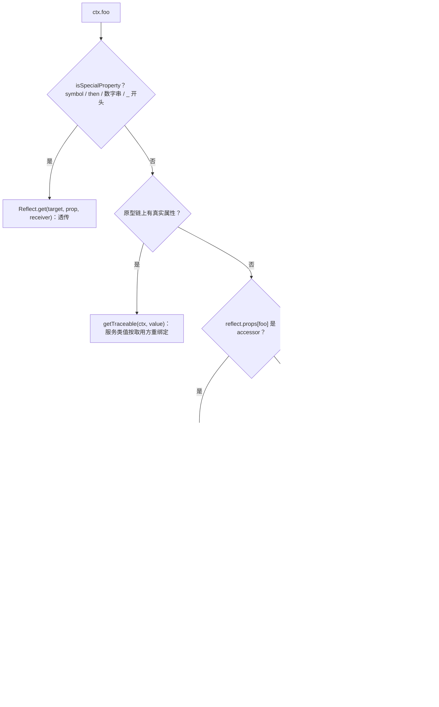

# Context：作者如何把"容器"做成一个属性访问

总纲见 [cordis-design.md](cordis-design.md)。本文按作者的设计顺序展开：先看要解决的问题，再看构建的模型与期望的
使用方式，最后看 TypeScript 如何一步步把它表达出来，以及过程中最容易被误读的几处。

## 1 要解决什么问题

### 1.1 场景

插件需要拿到别的插件提供的能力（模型、工具表、会话存储），并且这些能力必须能在不改使用点代码的前提下被替换。
同时，同一个能力在不同装配位置可能要用不同实现（例如每个 agent 一套 plan 状态）。

### 1.2 显然的做法与它为什么不够

最直接的做法是 import 具体实现；退一步是服务定位器 `ctx.get('llm')`。两者在插件体系里都会失效：前者让替换必须
改代码，后者把"现在有没有、在哪个作用域里有"的负担交给每个使用点，而且类型只能靠手写泛型。作者要的形态更接近
普通对象访问——`ctx.llm` 读起来就是一个字段，但每次读取实际上是一次解析。

### 1.3 由此确定的需求清单

| 需求 | 含义 |
|---|---|
| 按名解析 | 使用点只认识名字，不认识实现 |
| 作用域化 | 同一名字在不同装配位置可以解析到不同实现 |
| 可派生 | 派生新作用域要便宜、可嵌套、不改父级 |
| 静态可见 | 使用点仍要能拿到类型与自动补全 |
| 失败可诊断 | "没声明依赖"与"依赖暂时不可用"要能区分 |

## 2 作者构建的模型（artifact）

### 2.1 一个派生出来的对象树

Context 不是全局单例，也不是注册出来的对象，而是一棵用原型派生出来的树：根上下文在 `new Context()` 时创建，
每个插件拿到的是它的一层子上下文（
[context.ts:71](sources/deepseek-harness/vendor/cordis/src/context.ts#L71)<!-- doctidex: {cross-boundary-point: sources/deepseek-harness} -->、
[context.ts:99](sources/deepseek-harness/vendor/cordis/src/context.ts#L99)<!-- doctidex: {cross-boundary-point: sources/deepseek-harness} -->）。每次派生只做两件事：换一个原型，叠加若干
以 symbol 为键的映射（隔离、拦截）。

| 数据结构 | 位置 | 语义 |
|---|---|---|
| `Context` 实例 | [context.ts:42](sources/deepseek-harness/vendor/cordis/src/context.ts#L42)<!-- doctidex: {cross-boundary-point: sources/deepseek-harness} --> | 一个作用域节点；自己的 `fiber`、`root`、`baseUrl` |
| `symbols.isolate` 映射 | 每层自有或继承 | 服务名 → 作用域标签 |
| `symbols.intercept` 映射 | 每层自有或继承 | 服务名 → 传递给下游的配置 |
| `reflect.store` | [reflect.ts:209](sources/deepseek-harness/vendor/cordis/src/reflect.ts#L209)<!-- doctidex: {cross-boundary-point: sources/deepseek-harness} --> | 标签 → 实现记录 `Impl` |
| `reflect.props` | [reflect.ts:211](sources/deepseek-harness/vendor/cordis/src/reflect.ts#L211)<!-- doctidex: {cross-boundary-point: sources/deepseek-harness} --> | 名字 → 声明（服务 or accessor） |

### 2.2 三条不变量

1. **父级永不修改**：派生是纯函数式的，父上下文的行为不会因为子上下文而改变。
2. **可见性 = 依赖链 ∩ 隔离标签**：解析沿 fiber 链上溯，遇到标签不同即停止。
3. **解析失败必须显式**：不返回 `undefined`，而是抛带调用点的错误（[reflect.ts:144](sources/deepseek-harness/vendor/cordis/src/reflect.ts#L144)<!-- doctidex: {cross-boundary-point: sources/deepseek-harness} -->）。

## 3 期望的使用方式（心智模型）

### 3.1 插件作者

三种写法：读服务 `ctx.llm`；派生作用域 `const child = ctx.isolate('planMode')`；派生后挂插件
`child.plugin(PlanModePlugin)`。作者希望形成的直觉是"**派生出来的上下文是一份新的视图，不是新的容器**"——它不复制
任何实现，只改查找时用的标签；把上下文交给别的插件，等于把你这一层的解析能力也交给它（dsh 的
[packages/core/scope](sources/deepseek-harness/packages/core/scope)<!-- doctidex: {cross-boundary-point: sources/deepseek-harness} --> README 明确把这点写成注意事项）。

### 3.2 框架扩展者

扩展者会用到两个更底层的入口：`ctx.accessor(name, {get, set})` 声明计算属性；`ctx.mixin(source, keys)` 把某个服务
的成员暴露到上下文上。核心自己就靠 mixin 把 `ctx.on`、`ctx.plugin`、`ctx.effect` 这些方法挂出来
（[reflect.ts:219-222](sources/deepseek-harness/vendor/cordis/src/reflect.ts#L219)<!-- doctidex: {cross-boundary-point: sources/deepseek-harness} -->）——所以它们不是"上下文自带"，而是指向服务的转发属性。

### 3.3 反模式

用 `ctx.get(name, false)` 做"宽松读"等于放弃依赖保护；在服务方法里直接保存 `this.ctx` 到全局等于绕过归属规则；
在 `apply` 之外持有 `ctx` 并长期使用，会让作用域在插件卸载后仍然被引用。


### 3.4 示例：读取、宽松读、派生作用域与 accessor

```ts
// ① 读服务：先声明 inject，之后像取字段一样读
export const inject = ['llm']
export function apply(ctx: Context) {
  const stream = ctx.llm.stream({ prompt: 'hi' })     // 解析发生在这一次属性访问上
}

// ② 宽松读：不声明依赖也能取到，代价是失去「依赖不可用时不执行」的保护
export function apply(ctx: Context) {
  const llm = ctx.get('llm', false)                   // strict=false：提供者未激活也返回
}

// ③ 派生作用域：让同一个服务名在不同子树里解析到不同实现
export function apply(ctx: Context) {
  const scoped = ctx.isolate('planMode')              // 新的作用域标签，父级不受影响
  scoped.plugin(PlanModePlugin)                       // 该子树里的 ctx.planMode 只看到这一份
}

// ④ accessor 与 mixin：把计算属性、服务成员暴露到 ctx 上
export function apply(ctx: Context) {
  ctx.accessor('currentAgent', {
    get() { return this.agents.current },             // this = 调用方 ctx
  })
  ctx.mixin('agents', ['current'])                    // 于是 ctx.current 等价于 ctx.agents.current
}
```

要点：读取即解析；作用域是派生出来的视图而不是新的容器；`accessor` / `mixin` 是「往 ctx 上加属性」的两种方式；
`ctx.get(name, false)` 属于放宽依赖约束的入口，用它就放弃了「依赖不可用时不执行」的保护。写法取自 dsh 教程：

- [docs/cordis-tutorial/03-services.md](sources/deepseek-harness/docs/cordis-tutorial/03-services.md)<!-- doctidex: {cross-boundary-point: sources/deepseek-harness} -->

## 4 用 TypeScript 表达这套设计：作者遇到的问题与解法

这一章按"问题"组织，而不是按特性组织。每个小节回答四件事：作者要实现什么、最直接的写法为什么行不通、最终用了哪些机制、以及留下了什么代价。

### 4.1 环境是运行时派生出来的，类表达不了

作者要的编程模型是"每个插件看到同一个 `ctx`，但解析结果按它的位置而定"。类在这里遇到硬约束：类的形状在编译期固定，而上下文树的层数是运行时才知道的（配置决定挂了哪些插件、哪些作用域被隔离）。于是作者把**运行时容器**与**类型面**拆成两件事：`Context` 类负责实例与派生（`Object.create` 链），同名的 `Context` 接口负责描述"合并之后的样子"，插件用 `declare module` 往接口里加成员。
这解释了一个常见疑问：为什么 `ctx.llm` 这类属性在类声明里找不到却仍然有类型。代价也在这里——类型面与运行时不同源，`mixin` 动态加属性时，`declare module` 里必须手写对应的方法（§4.5）。

### 4.2 内部协议键不能与用户属性共存

上下文是"用户与服务共用"的对象：插件往上加 `llm`、`tools`，框架也要在同一个对象上挂 `effect`、`isolate`、`intercept` 这类内部入口。字符串键会重名；`#private` 字段又挡住了框架的通用逻辑（框架需要在任意上下文上读写这些键）。作者的解法是 **`unique symbol` 静态成员**：键的实体由 `Symbol.for` 创建（跨 realm、跨副本相等），静态成员则让这个键可以被写进类型。
代价：符号不能字符串化，调试与序列化都要额外处理；文档必须解释这些"看起来像保留字的成员"到底是什么。

### 4.3 `ctx.foo` 的语义依赖"谁在问"，类型系统表达不了

这是类型层最无力的一处：同一个 `ctx.llm` 在插件 A 与 B 里可能解析到不同实现；同一个服务实例被谁取用，就该以谁的身份出现（[cordis-traceable.md](cordis-traceable.md)）。类型系统能表达"取到的是 `LlmService`"，表达不了"这个值绑定在谁身上"。
作者的选择是：**把归属语义放进运行时的 Proxy，把类型留在形状层**——`get` / `set` / `apply` 三个陷阱承担解析与重绑定，类型只保证取到的东西"看起来像"服务。代价是一份诚实的清单：类型看不见归属，也看不见某次解析是否会失败（见 §6.2）。

### 4.4 品牌判断要在代理与多副本环境里仍然可靠

框架需要"这是不是 Context"的判断，且要跨副本、跨 realm 成立（同一进程里可能有两份 cordis）。`instanceof` 在代理下不可靠（构造函数可能是 Proxy），跨副本也会失败。作者的解法是**全局符号品牌**：`Context.is` 本身带 `Symbol.toPrimitive`，被当属性键使用时求值成 `Symbol.for('cordis.is')`，于是它既能当函数调用又能当键读取。同一类需求在服务侧由手写的 `Symbol.hasInstance` 承担。

### 4.5 类型面与运行时不同源的两处裂缝

第一处是 `mixin`：运行时用生成器逐个 `accessor` 把服务的成员转发到 `ctx`，类型上却必须手写 `interface Context` 的方法声明。第二处是 `accessor` 本身：它声明"每次读取现算"的属性，类型层只能看到一个属性类型，看不到背后的 getter。
这不是疏忽，而是 TypeScript 的边界——**运行时可以遍历、可以代理，静态类型不能**。作者用严格的声明块与详细 JSDoc 补偿，让类型与文档成为同一份契约的两种形式。

## 5 机制精读：一次 `ctx.foo` 发生了什么



**为什么先排除特殊键**（[reflect.ts:86](sources/deepseek-harness/vendor/cordis/src/reflect.ts#L86)<!-- doctidex: {cross-boundary-point: sources/deepseek-harness} -->）：读 `ctx[Context.effect]`、`await ctx`（会读 `then`）不能触发解析，
否则内部机制与用户代码会互相误读对方的键。数字串与 `_` 前缀是作者留的约定，避免数组式/私有式访问被当成服务名。

**为什么区分"真实属性"与"服务"**：`root`、`events`、`fiber` 这些是实例上的真属性，取它们不需要作用域判断；
服务必须按作用域解析。两类走不同分支，前者也要过 `getTraceable`——因为诸如 `ctx.events` 这样的服务同样要按取用方
重绑定（见 [cordis-traceable.md](cordis-traceable.md)）。

**为什么要预造 error**：错误信息需要调用点堆栈。作者在进入解析前就 new 一个（[reflect.ts:144](sources/deepseek-harness/vendor/cordis/src/reflect.ts#L144)<!-- doctidex: {cross-boundary-point: sources/deepseek-harness} -->），失败时直接抛它，
省掉了在深调用栈里重建位置的麻烦。

## 6 机制精读：作用域是怎么派生与隔离的

### 6.1 extend：派生一层

`extend(meta)` 用 `Object.create(getTraceable(this, this))` 造子对象，再把 `meta` 的自有属性原样定义上去
（[context.ts:99](sources/deepseek-harness/vendor/cordis/src/context.ts#L99)<!-- doctidex: {cross-boundary-point: sources/deepseek-harness} -->）。父级不被修改；子对象通过原型链继承父级的一切，这正是"作用域是视图不是副本"的实现。

### 6.2 isolate：只改一个标签

`isolate(name, label)` 造一个新的标签映射（`Object.create(父的映射)`），把 `name → label` 写进自有层
（[context.ts:121](sources/deepseek-harness/vendor/cordis/src/context.ts#L121)<!-- doctidex: {cross-boundary-point: sources/deepseek-harness} -->）。解析时（
[reflect.ts:164](sources/deepseek-harness/vendor/cordis/src/reflect.ts#L164)<!-- doctidex: {cross-boundary-point: sources/deepseek-harness} -->）比较的正是这个标签，所以隔离的成本是"一次对象创建 + 一次比较"。
两个 `isolate` 传同一个 label 就会共享作用域——这也是 loader 的 `isolate: someLabel` 能实现"同名共享 realm"的
原因（[vendor/loader/src/config/isolate.ts](sources/deepseek-harness/vendor/loader/src/config/isolate.ts)<!-- doctidex: {cross-boundary-point: sources/deepseek-harness} -->）。

### 6.3 intercept：同样是标签，但传的是配置

`intercept(name, config)` 叠加的是配置映射（[context.ts:141](sources/deepseek-harness/vendor/cordis/src/context.ts#L141)<!-- doctidex: {cross-boundary-point: sources/deepseek-harness} -->），服务在读取配置时按祖先顺序合并
（[service.ts:86](sources/deepseek-harness/vendor/cordis/src/service.ts#L86)<!-- doctidex: {cross-boundary-point: sources/deepseek-harness} -->）。它和 isolate 共用"派生一层影子"的写法，区别只在消费者是谁：isolate 影响**解析到哪个实现**，
intercept 影响**实现拿到的配置**。

## 7 难点与晦涩点

### 7.1 "ctx 的第三参为什么叫 ctx"

Proxy 的 `get` trap 签名是 `(target, prop, receiver)`。作者把 receiver 命名为 `ctx`，因为在这个框架里 receiver 就是
"这次读取的发起方"。理解这一点，才能读懂 `ctx[symbols.shadow] ?? ctx`（[reflect.ts:155](sources/deepseek-harness/vendor/cordis/src/reflect.ts#L155)<!-- doctidex: {cross-boundary-point: sources/deepseek-harness} -->）这类代码：它判断的是"这次读取是不是
从一个服务的内部发出的"。

### 7.2 `_store`、`store`、`props`、`store[key]` 不是一回事

`fiber.store` 是某个 fiber 的"可用实现快照"，`reflect.store` 是全局实现池（按标签索引），`reflect.props` 是名字的
声明表。三者混起来看会非常费解，建议按"谁在维护、按什么键、何时变化"三列去记（本文 §2.1）。

### 7.3 根上下文为什么可以宽松读

根 fiber 的 `runtime` 为 `null`（它不是被挂载出来的插件），框架认为根不受 `inject` 约束，于是
`reflect.get(name, false)` 直接返回值（[reflect.ts:152](sources/deepseek-harness/vendor/cordis/src/reflect.ts#L152)<!-- doctidex: {cross-boundary-point: sources/deepseek-harness} -->）。这解释了为什么"根上下文能拿到还没激活的服务"，而插件
上下文不行。

## 8 未验证

`internal/get` / `internal/set` 在产品侧是否有监听者（本副本 [packages/](sources/deepseek-harness/packages/)<!-- doctidex: {cross-boundary-point: sources/deepseek-harness} --> 内未检出）；深层嵌套 isolate 的标签冲突
处理依赖调用方约定，未做实验；`associate` 分支（[utils.ts:180](sources/deepseek-harness/vendor/cordis/src/utils.ts#L180)<!-- doctidex: {cross-boundary-point: sources/deepseek-harness} -->，把上下文上的「`<服务名>.<成员>`」属性读作服务成员）在本副本没有使用者。

## 9 来源

- 引入副本（tag `dsh-v0.2.1-rc.3`）：[sources/deepseek-harness](sources/deepseek-harness)<!-- doctidex: {cross-boundary-point: sources/deepseek-harness} -->
  - 本文引用的文件：
    - [vendor/cordis/src/context.ts](sources/deepseek-harness/vendor/cordis/src/context.ts)<!-- doctidex: {cross-boundary-point: sources/deepseek-harness} -->
    - [reflect.ts](sources/deepseek-harness/vendor/cordis/src/reflect.ts)<!-- doctidex: {cross-boundary-point: sources/deepseek-harness} -->
    - [utils.ts](sources/deepseek-harness/vendor/cordis/src/utils.ts)<!-- doctidex: {cross-boundary-point: sources/deepseek-harness} -->
    - [vendor/loader/src/config/isolate.ts](sources/deepseek-harness/vendor/loader/src/config/isolate.ts)<!-- doctidex: {cross-boundary-point: sources/deepseek-harness} -->
