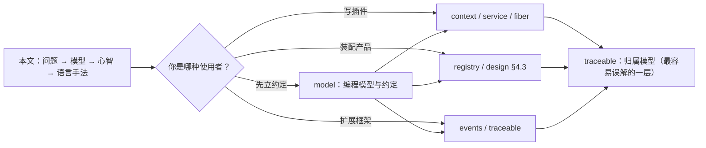
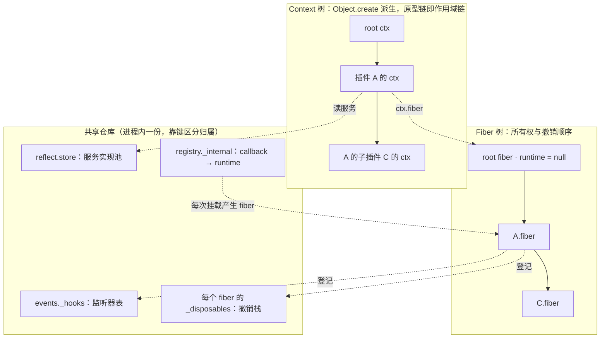
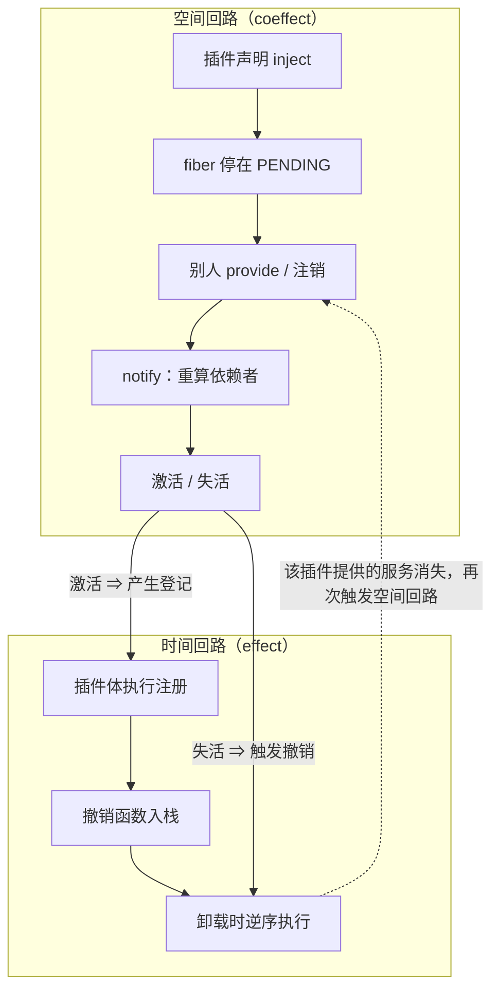
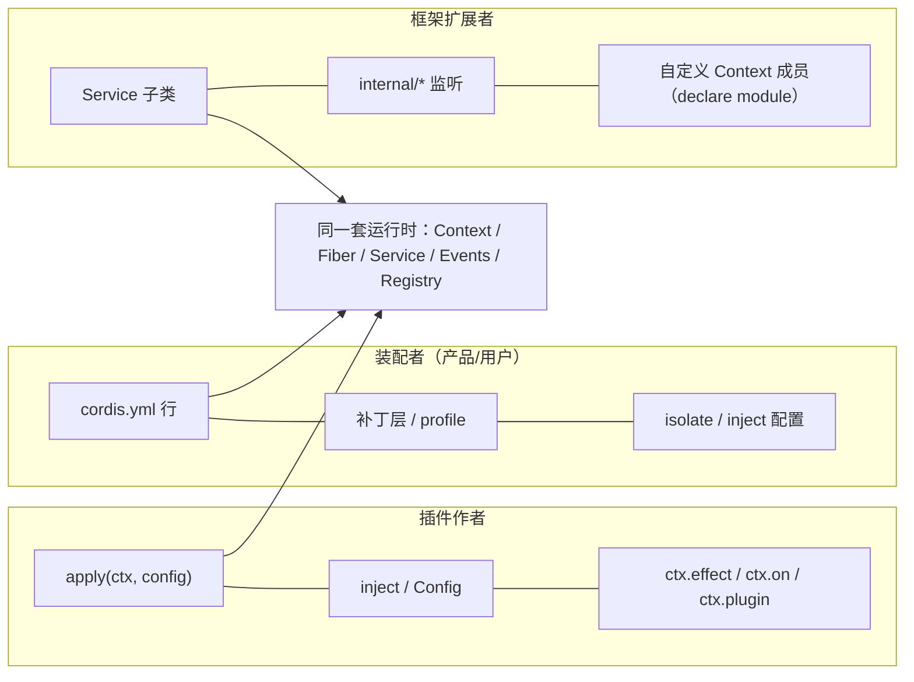
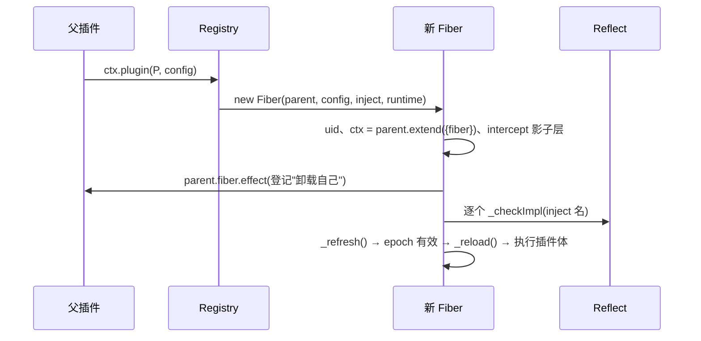
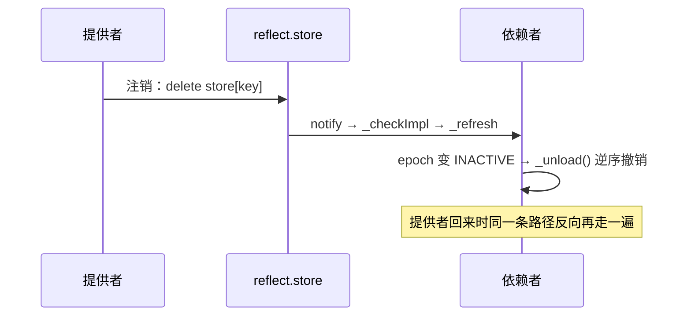
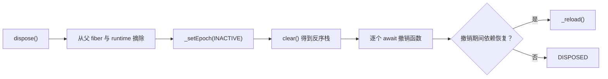

# Cordis 设计复盘：作者要解决的问题、构建的模型与交付的心智

这不是一份"框架说明书"，而是一次设计复盘。顺序刻意按作者做决定的顺序排：**先有问题，再有模型，再有使用方式，
最后才是 TypeScript 的实现手法**。每篇子文档都遵守这个顺序，因为反过来（先看某个 trap 的分支，再猜它为什么存在）
是阅读这套代码时最容易失去方向的方式。

## 1 立场与阅读方式

### 1.1 这份文档想做什么

把 Cordis 的设计（作者怎么想）与实现（代码怎么做）分开讲清楚：**设计**回答"为什么需要这个抽象、使用者该怎么用它"，
**实现**回答"用什么语言机制把这份设计表达出来、难点在哪里"。前者是心智模型，后者是 TypeScript 层面的手法与取舍。

### 1.2 读者路径



### 1.3 证据约定

**代码事实**给出 `文件:行号` 并附可跳转链接；**文档事实**注明来自 dsh 自述或论文摘要；**推断**指作者未明说、由实现
结构反推的动机，统一标注"（推断）"。论文（arXiv:2608.25512）只取到摘要，不引申其形式化结论。

## 2 作者面对的问题

### 2.1 表层需求：一切皆插件

dsh 的 README 把 Cordis 描述为"everything-is-a-plugin" 的底座：模型适配器、工具注册表、会话日志、agent 循环本身
都是插件（[docs/architecture.md](sources/deepseek-harness/docs/architecture.md)<!-- doctidex: {cross-boundary-point: sources/deepseek-harness} -->）。这句话对框架提出的要求不是"支持插件"，而是**支持插件随时被换掉、被组合、
被拆掉，而不破坏正在运行的系统**。

### 2.2 三个具体痛点

把"支持插件"当成需求会得到最显然的方案：一个注册表加一组回调，卸载时手动调用清理。这个方案会同时遇到三个问题，而 Cordis 的每个抽象都对应其中一个：

| 痛点 | 具体表现 | 对应抽象 |
|---|---|---|
| 顺序：谁先启动 | 手动排启动顺序，任何插入/删除都会破坏它 | inject / 依赖通知（Service、Fiber） |
| 清理：谁负责回收 | 插件注册的监听器、定时器、子插件要逐个记住并注销 | effect 协议（Fiber） |
| 替换：换一个实现 | 使用点 import 了具体实现，替换要改一片代码 | Context 的按名解析与作用域（Context） |

### 2.3 论文给出的抽象

dsh README 指向的论文把问题拆成两个正交维度：**temporal composability**（组件被移除时完整回滚副作用，机制是
revertible effect）与 **spatial composability**（组件声明依赖并对依赖变化作出反应，机制是 reactive coeffect），
两者统一到同一个 context 类型上。Cordis 的实现几乎是这句话的逐字翻译：

| 论文机制 | 代码落点 |
|---|---|
| revertible effect | `ctx.effect()` 返回撤销函数，卸载时逆序执行（[fiber.ts:418](sources/deepseek-harness/vendor/cordis/src/fiber.ts#L418)<!-- doctidex: {cross-boundary-point: sources/deepseek-harness} -->） |
| reactive coeffect | `inject` 声明 + `provide/notify` 驱动激活与失活（[reflect.ts:314](sources/deepseek-harness/vendor/cordis/src/reflect.ts#L314)<!-- doctidex: {cross-boundary-point: sources/deepseek-harness} -->） |
| 统一的 context | 同一个 `Context` 既是副作用宿主，也是依赖宿主（[context.ts:42](sources/deepseek-harness/vendor/cordis/src/context.ts#L42)<!-- doctidex: {cross-boundary-point: sources/deepseek-harness} -->） |

### 2.4 由此确定的三条设计准则

1. **时间维**：任何注册都要能撤销，且撤销顺序可预测。
2. **空间维**：任何依赖都要能声明，且依赖变化能自动传导。
3. **使用者视角无感**：这两件事不能靠额外的 API 仪式，要让作者写得像普通对象访问。

## 3 作者构建的模型（artifact）

### 3.1 运行时对象图



### 3.2 两条回路



两条回路合成一条因果链：**依赖变化 → 卸载 → 撤销 → 服务消失 → 别人的依赖变化**。Cordis 没有中心调度器，也没有
"启动阶段/关闭阶段"的概念，这两条回路就是全部。

### 3.3 五个抽象各自的职责

| 抽象 | 一句话职责 | 作者要使用者记住的心智 | 精读 |
|---|---|---|---|
| Context | 解析服务、派生作用域 | `ctx.x` 是"按当前作用域解析"，不是取字段 | [cordis-context.md](cordis-context.md) |
| Service | 声明能力与存活期 | 注册即生效，随插件一起卸载 | [cordis-service.md](cordis-service.md) |
| Fiber | 一次挂载的生命周期与撤销 | 我只管注册，撤销由框架逆序执行 | [cordis-fiber.md](cordis-fiber.md) |
| Events | 扩展点契约 | 事件模式（观察/决策/包裹）是接口的一部分 | [cordis-events.md](cordis-events.md) |
| Registry | 插件形状与实例 | 同一插件可多次挂载，每次一个实例 | [cordis-registry.md](cordis-registry.md) |
| （横切）归属 | 一个实例服务多个调用方时"按谁算" | 见下方 §4.5 与专文 | [cordis-traceable.md](cordis-traceable.md) |

## 4 提交给使用者的心智模型

框架的设计一半在代码里，另一半在"使用者以为自己在写什么"里。本节只给结论；完整的约定清单、违反后的现象与反例见 [cordis-model.md](cordis-model.md)。Cordis 实际服务三类使用者，本节把三类人的心智模型
分别写清。

### 4.1 三类使用者与各自的 API 面



### 4.2 插件作者的心智

作者希望插件作者形成的直觉是：**"我只负责声明，框架负责时机的正确性。"** 具体表现为三条约定：

- 我写 `inject: ['tools']`，就不必关心工具插件是否存在、谁先加载；依赖不满足时我的 `apply` 根本不会被调用 （[registry.ts:19](sources/deepseek-harness/vendor/cordis/src/registry.ts#L19)<!-- doctidex: {cross-boundary-point: sources/deepseek-harness} -->、[fiber.ts:611](sources/deepseek-harness/vendor/cordis/src/fiber.ts#L611)<!-- doctidex: {cross-boundary-point: sources/deepseek-harness} -->）。
- 我调用 `ctx.on(...)`、`ctx.effect(...)`、`ctx.plugin(...)`，就不必写清理代码；卸载时它们按逆序自动撤销 （[fiber.ts:418](sources/deepseek-harness/vendor/cordis/src/fiber.ts#L418)<!-- doctidex: {cross-boundary-point: sources/deepseek-harness} -->）。
- 我的 `apply` 会被执行多次（依赖换实现、普通配置更新、HMR 都会导致卸载再装载；volatile-only 配置由 loader 原地提交），所以它必须可重复执行（[docs/cordis-primer.md](sources/deepseek-harness/docs/cordis-primer.md)<!-- doctidex: {cross-boundary-point: sources/deepseek-harness} -->）。

> **Changed in `dsh-v0.2.1-rc.3`**（相对历史参考版本 `dsh-v0.1.5-rc.2`）：volatile-only 配置更新不再导致 `apply` 重新执行；
> `Fiber.update()` 也不再返回 `internal/update` waterfall 的结果。
>
> 历史参考版本的实现见 [fiber.ts:748](sources/deepseek-harness-v0.1.5-rc.2/vendor/cordis/src/fiber.ts#L748)<!-- doctidex: {cross-boundary-point: sources/deepseek-harness-v0.1.5-rc.2} -->。

### 4.3 装配者的心智

对写配置的人，作者希望形成的直觉是：**"配置树里的每一行就是一个插件实例，任何一行都可以被上层替换。"** 加载器把
每行配置变成一个 Entry、一次 `ctx.plugin()`；补丁层按 id 替换整行配置；`isolate` 让某一行及其子树拥有一套独立的
服务实现（[vendor/loader/src/config/isolate.ts](sources/deepseek-harness/vendor/loader/src/config/isolate.ts)<!-- doctidex: {cross-boundary-point: sources/deepseek-harness} -->）。dsh 的产品装配（profile → bundle → 用户补丁）就完全建立在这个
模型上，核心不需要为"多套配置"写任何特例。

### 4.4 框架扩展者的心智

对写核心级功能的人，作者希望形成的直觉是：**"没有特权内核，你可以像别的插件一样接入。"** 框架自身的关键动作都被
暴露成 `internal/*` 事件（[events.ts:329](sources/deepseek-harness/vendor/cordis/src/events.ts#L329)<!-- doctidex: {cross-boundary-point: sources/deepseek-harness} -->），服务读写、配置解析、插件挂载都可以被包裹或否决。加载器正是这样接进来
的：它没有 import 核心内部实现，而是监听 `internal/plugin`、`internal/config`、`internal/update`。

### 4.5 三类人共用的两条隐藏约定

第一，**归属**：同一个服务实例会被多个插件使用，框架必须替使用者回答"这次调用按谁的依赖解析、副作用归属给谁、
身份判断看谁"。这条约定没有出现在任何 API 签名里，却决定了所有服务的行为（详见 [cordis-traceable.md](cordis-traceable.md)）。
第二，**可重复执行**：任何插件体都要假设自己会被装载多次；任何服务都要假设自己会被替换（这就是为什么注册必须是
effect，而不是一次性的 `if (!registered)`）。


### 4.6 示例：插件作者写出的最小插件

```ts
// greeter.ts：声明依赖、声明配置、注册监听器与自建资源——没有一处需要手写清理
import type { Context } from '@deepseek-ai/cordis'
import Schema from '@deepseek-ai/schemastery'

export const name = 'greeter'
export const inject = ['sessions']        // sessions 不就绪时，apply 不会被调用

export interface Config {
  prefix: string
}
export const Config: Schema<Config> = Schema.object({
  prefix: Schema.string().default('hello'),
})

export function apply(ctx: Context, config: Config) {
  ctx.on('agent/created', (agent) => {              // 监听器是 effect：插件卸载即注销
    ctx.logger.info('%s %s', config.prefix, agent.id)
  })

  ctx.effect(() => {                                // 自建资源必须显式登记撤销
    const timer = setInterval(() => ctx.sessions.sweep(), 60_000)
    return () => clearInterval(timer)
  })
}
```

要点：`inject` 决定何时启动、注册即注销、`apply` 允许被重复执行——正好对应 §4.2 的三条约定。写法取自 dsh 教程的
第 1、2、3 章。

### 4.7 示例：一次装配与一次替换（装配者视角）

```yaml
# cordis.yml：每一行就是一个插件实例；id 让 loader 能区分「改这一行」与「删掉再加」
- id: base-llm
  name: '@deepseek-ai/dsh-llm-deepseek'
  config:
    model: deepseek-chat
- id: sandbox
  name: cordis:group                # 分组：整组作为一个装载单位
  group: true
  isolate:
    shell: local                    # 这一组拥有自己的 shell 服务实例
  config:
    - id: shell-local
      name: '@deepseek-ai/dsh-shell-local'
- id: sandbox-alt
  name: '@deepseek-ai/dsh-shell-remote'
  disabled: true                    # 保留行但不挂载；改成 false 即可换实现
```

替换一个能力不需要改动使用方：换掉提供者那一行（或在上层补丁里按 id 替换整行），旧服务的卸载会唤醒依赖者，让它们
对新实现重新装载。

### 4.8 示例：框架扩展者的观察插件

```ts
// observer.ts：只监听 internal/*，不 import 任何核心实现
import type { Context } from '@deepseek-ai/cordis'

export const name = 'observer'

export function apply(ctx: Context) {
  ctx.on('internal/plugin', (fiber) => {
    if (!fiber.uid) return                       // uid 为 null 表示这次是销毁
    ctx.logger.debug('plugin mounted: %s', fiber.name)
  })

  // 注册监听器一律用 on()/once()；这个事件由 Fiber.update() 用 ctx.waterfall 派发，
  // 因此监听者拿到的是 (config, noSave, next)：调用 next() 继续，不调用即否决
  ctx.on('internal/update', function (config, noSave, next) {
    return next()
  }, { prepend: true })
}
```

要点：外部包接入核心靠的是事件名而不是内部 API（§4.5）；`internal/*` 只能监听，不能主动派发。

## 5 一次挂载的生命周期（作者视角）

### 5.1 挂载



顺序上有个刻意的细节：**先登记撤销函数，再对外发布 fiber**（[fiber.ts:265](sources/deepseek-harness/vendor/cordis/src/fiber.ts#L265)<!-- doctidex: {cross-boundary-point: sources/deepseek-harness} -->）。这样即使观察者在发布事件里立刻
dispose 它，回收路径也已经存在。

### 5.2 依赖变化



### 5.3 卸载



### 5.4 状态与触发条件

| 状态 | 由什么决定 | 触发什么 |
|---|---|---|
| PENDING | epoch 为 INACTIVE（有 inject 未满足） | 等 notify |
| LOADING | 正在 `_reload()` | 配置校验、执行插件体 |
| ACTIVE | epoch 有效且插件体返回 | 服务可见、可供依赖 |
| FAILED | `_error` 非空 | 依赖变化或 restart 时重试 |
| UNLOADING | 正在 `_unload()` | 逆序撤销；期间禁止新登记 |
| DISPOSED | `uid === null` | 再使用抛 `INACTIVE_EFFECT` |

## 6 TypeScript 作为设计语言

### 6.1 作者要的"类型形态"

作者没有把类型当成"给 JavaScript 加注解"，而是当成设计的一部分：**运行时只有一份容器，类型面由所有人拼装出来；
使用者看到的属性访问与作者实现的解析机制必须是同一件事的两种表述**。这决定了几类必须在类型层解决的需求：

| 需求 | 若没有类型层支持会怎样 | 作者选用的机制 |
|---|---|---|
| 服务名 → 类型的映射 | `ctx.llm` 只能是 `any` | 声明合并（`interface Context`） |
| 事件名 → 参数/返回/模式 | 监听器签名靠文档约定 | 方法签名 + 条件类型提取 |
| 配置类型 → 插件/服务 | 配置只能手写类型断言 | 幻影成员、条件类型、可变元组 |
| 内部协议点 | 字符串键会与业务属性重名 | `unique symbol` 静态成员 |
| 可替换实例的身份 | `instanceof` 在代理下失真 | 自定义 `Symbol.hasInstance` |

### 6.2 四类手法

**声明合并**：`interface Context` 与 `interface Events` 是开放接口，核心文件与插件都能往里加成员（[context.ts:16](sources/deepseek-harness/vendor/cordis/src/context.ts#L16)<!-- doctidex: {cross-boundary-point: sources/deepseek-harness} -->、
[events.ts:329](sources/deepseek-harness/vendor/cordis/src/events.ts#L329)<!-- doctidex: {cross-boundary-point: sources/deepseek-harness} -->）。这是"容器只有一份、类型由多人拼装"的直接实现。

**符号协议键**：`Service.init/check/config/invoke/extend/filter/tracker/resolveConfig` 全部是 `unique symbol`
（[service.ts:13-25](sources/deepseek-harness/vendor/cordis/src/service.ts#L13)<!-- doctidex: {cross-boundary-point: sources/deepseek-harness} -->），既避免重名，又能作为类型系统里的键（幻影成员 `declare [symbols.config]: T`）。

**幻影与推导**：`Service<out T>` 的配置类型不产生运行时字段，只用于推导；`InjectKey` 用映射类型 + 键重映射筛出
合法服务名（
[registry.ts:22](sources/deepseek-harness/vendor/cordis/src/registry.ts#L22)<!-- doctidex: {cross-boundary-point: sources/deepseek-harness} -->）；`Spread<T>` / `GetPluginConfig<P>` 从插件形状推导参数（
[registry.ts:148](sources/deepseek-harness/vendor/cordis/src/registry.ts#L148)<!-- doctidex: {cross-boundary-point: sources/deepseek-harness} -->）。

**代理重绑定**：类型系统无法表达"同一个实例按取用方表现为不同身份"，作者把这件事交给运行时代理（`getTraceable`），
类型层只保证取到的是"服务类型"。代价是类型看不见归属，见 §6.4。

### 6.3 工程约束反过来影响设计

vendored 版本记录了三条与类型有关的工程决定（[vendor/README.md](sources/deepseek-harness/vendor/README.md)<!-- doctidex: {cross-boundary-point: sources/deepseek-harness} -->）：内部相对导入显式写 `.ts`（配合
`allowImportingTsExtensions` 与 `rewriteRelativeImportExtensions`）、标记可擦除语法以适配 Node 原生 TS 转换、
JSDoc 必须齐备以供给 API 生成器（[scripts/gen-cordis-api.ts](sources/deepseek-harness/scripts/gen-cordis-api.ts)<!-- doctidex: {cross-boundary-point: sources/deepseek-harness} -->）。也就是说这套类型不只是给编译器看的，它同时是
文档与生成器的输入——这解释了为什么核心代码的注释密到几乎像规范。

### 6.4 类型层看不见的部分（诚实清单）

类型系统表达不了三件事，作者用运行时报错补足：依赖未声明（`cannot get property … without inject`）、依赖未激活
（`cannot get required service … in inactive context`）、归属（`ctx.foo` 返回的代理到底绑在谁身上）。理解这一点，
才能理解为什么框架宁可牺牲"静态可判定"，也要换取"写法自然"。

## 7 为什么不是别的做法

| 更显然的做法 | 会付出什么代价 | 作者的选择（推断） |
|---|---|---|
| 服务定位器 `ctx.get('name')` | 每个使用点都要处理"还没有"，类型靠手写泛型 | 属性访问 + Proxy 解析（[reflect.ts:135](sources/deepseek-harness/vendor/cordis/src/reflect.ts#L135)<!-- doctidex: {cross-boundary-point: sources/deepseek-harness} -->） |
| EventEmitter + 字符串事件 | 无法区分"观察 / 决策 / 包裹"，也无法给事件定契约 | 五种派发模式写进类型契约（[events.ts:32](sources/deepseek-harness/vendor/cordis/src/events.ts#L32)<!-- doctidex: {cross-boundary-point: sources/deepseek-harness} -->） |
| 插件写 `start/stop` 两个方法 | 作者要维护对称性，遗漏即泄漏 | 注册返回撤销函数，框架逆序执行（[fiber.ts:418](sources/deepseek-harness/vendor/cordis/src/fiber.ts#L418)<!-- doctidex: {cross-boundary-point: sources/deepseek-harness} -->） |
| 用 `using` / `Symbol.dispose`（显式资源管理） | 生命周期只能随词法作用域结束，且难以收集"运行期产生的多项登记" | 自建 effect 协议，支持生成器与异步迭代器（[fiber.ts:83](sources/deepseek-harness/vendor/cordis/src/fiber.ts#L83)<!-- doctidex: {cross-boundary-point: sources/deepseek-harness} -->） |
| 每个插件一份服务实例 | 内存与初始化成本高，且失去"替换实现"的单一入口 | 单实例 + 按调用方重绑定（[cordis-traceable.md](cordis-traceable.md)） |
| 编译期确定插件树（如插件式静态装配） | 无法支持运行期换实现、热更、按配置分叉 | 运行期插件树 + 配置层（loader） |

这些取舍都不是"更简单"，而是把复杂度从使用者转移到了框架内部：使用者的代码接近普通函数与对象访问，代价是框架
必须实现代理、作用域标签、epoch、撤销栈这些机制——也就是本系列后面几篇的全部内容。

## 8 文档地图

| 文档 | 回答的问题 | 适合谁 |
|---|---|---|
| [cordis-model.md](cordis-model.md) | 编程模型与约定：该怎么写、违反后发生什么、反例 | 写插件之前 |
| [cordis-context.md](cordis-context.md) | `ctx` 是什么、读取时发生了什么、作用域怎么派生 | 所有使用者 |
| [cordis-service.md](cordis-service.md) | 怎么提供/替换能力，服务配置与可用性怎么表达 | 写服务、做装配 |
| [cordis-fiber.md](cordis-fiber.md) | 生命周期、撤销、依赖变化的完整机制 | 写插件、排时序问题 |
| [cordis-events.md](cordis-events.md) | 事件模式、监听器生命周期、`internal/*` | 挂扩展点、做拦截 |
| [cordis-registry.md](cordis-registry.md) | 插件是什么、三种写法、多实例与配置校验 | 插件作者、工具链 |
| [cordis-traceable.md](cordis-traceable.md) | 归属模型：traceable / shadow / noShadow / receiver | 想真正读懂服务行为的人 |

## 9 未验证事项

1. 论文全文只读到摘要，形式化部分未核实。
2. 上游 `cordiverse/cordis` 的演进历史（引入副本只有 1 个提交），看不到作者的迭代过程。
3. 当前 `dsh-v0.2.1-rc.3` 的 [vendor/cordis/package.json](sources/deepseek-harness/vendor/cordis/package.json)<!-- doctidex: {cross-boundary-point: sources/deepseek-harness} --> 版本为 `4.0.5`，与 [vendor/README.md](sources/deepseek-harness/vendor/README.md)<!-- doctidex: {cross-boundary-point: sources/deepseek-harness} --> 清单的 `4.0.0-rc.7` 不一致；`dsh-v0.1.5-rc.2` 时为 `4.0.2`（历史参考版本的 [package.json](sources/deepseek-harness-v0.1.5-rc.2/vendor/cordis/package.json)<!-- doctidex: {cross-boundary-point: sources/deepseek-harness-v0.1.5-rc.2} -->）。原因未核实。
4. 论文中的术语与代码命名的对应关系是我按语义匹配的（例如 revertible effect ↔ `ctx.effect`），作者未逐条声明。
5. loader / include / hmr 的装载与回滚机制（本系列尚未单独成篇）。
6. 性能画像：Proxy 解析与 epoch 字符串拼接在高插件数量下的成本。

> **Changed in `dsh-v0.2.1-rc.3`**（相对历史参考版本 `dsh-v0.1.5-rc.2`）：loader 不再包含显式的 entry 级 rollback；
> 此前 `Entry.update()` 带事务式回滚（先算 diff、失败回滚）。
>
> 历史参考版本的实现见 [entry.ts:142](sources/deepseek-harness-v0.1.5-rc.2/vendor/loader/src/config/entry.ts#L142)<!-- doctidex: {cross-boundary-point: sources/deepseek-harness-v0.1.5-rc.2} -->。

## 10 来源索引

- 引入的 Git 仓库（tag `dsh-v0.2.1-rc.3`）：[sources/deepseek-harness](sources/deepseek-harness)<!-- doctidex: {cross-boundary-point: sources/deepseek-harness} -->
  - commit `fb2c4b9e698e30edb738bca4cf0618587db7d203`；2026-09-14 导入，2026-09-17 阅读
  - 上游 cordis 标识（取自 [vendor/README.md](sources/deepseek-harness/vendor/README.md)<!-- doctidex: {cross-boundary-point: sources/deepseek-harness} --> 清单）：`github.com/cordiverse/cordis`，commit `56b3d4f725681cf4556c1a8695a709cc3b6eed74`
  - 核心源码入口：[vendor/cordis/src/](sources/deepseek-harness/vendor/cordis/src/)<!-- doctidex: {cross-boundary-point: sources/deepseek-harness} -->
- 论文（非 Git 资料，按 URL 引用）：Yifan Shi, Wei Zhang, Tianyi Cui,
  [arXiv:2608.25512](https://arxiv.org/abs/2608.25512), 2026-08-26（读取日期 2026-09-17，仅摘要）
