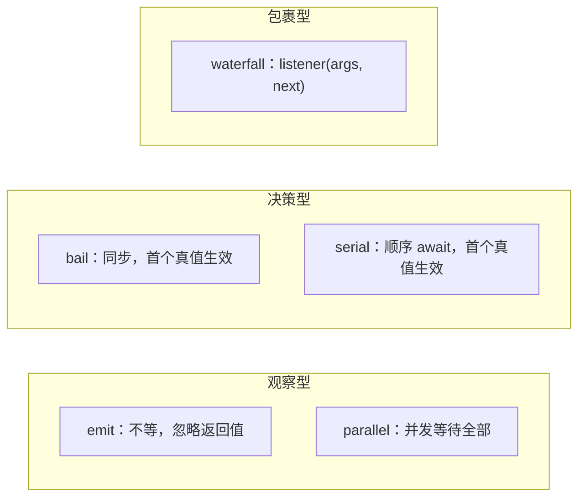

# Events：作者如何把"扩展点"写成一份契约

总纲见 [cordis-design.md](cordis-design.md)。本文按作者的设计顺序展开：事件要解决什么、事件总线被造成什么样、
使用者应该带着什么样的预期去监听或派发，以及 TypeScript 如何让这套契约可检查。

## 1 要解决什么问题

### 1.1 场景

dsh 的扩展点大多不是"替换一个函数"，而是"在某个流程中间插入一段逻辑"：工具执行前改写参数、模型请求前裁剪上下文、
提示词组装时插入一段说明、关闭时等各个子系统收尾。这些插入点的语义并不相同：有的只是观察，有的可以否决，有的
必须按顺序执行，有的要包裹后续流程。

### 1.2 显然做法的代价

| 做法 | 代价 |
|---|---|
| `EventEmitter` 式的"事件名 + 参数" | 没有统一语义：能不能否决、是否等待、顺序如何全靠文档 |
| 单一中间件栈（koa 式） | 只有"包裹"一种语义；观察型与并行收尾型都得挤进同一形状 |
| 每个扩展点自己发明 API（hook 对象、回调注册表） | 使用者要学 N 套约定，生命周期也各自为政 |
| 只用返回值传递决策 | 无法表达"并行等待"与"谁先谁后" |

作者的方案是：保留"事件"这个人人都会的模型，但把**派发语义**提升为事件契约的一部分——声明事件时就要说明它属于
哪一种模式。

### 1.3 需求清单

| 需求 | 对应设计 |
|---|---|
| 观察/决策/顺序/包裹四种语义 | 五种派发模式（[events.ts:32](sources/deepseek-harness/vendor/cordis/src/events.ts#L32)<!-- doctidex: {cross-boundary-point: sources/deepseek-harness} -->） |
| 事件可按作用域过滤 | `thisArg[Context.filter]`（[events.ts:165](sources/deepseek-harness/vendor/cordis/src/events.ts#L165)<!-- doctidex: {cross-boundary-point: sources/deepseek-harness} -->） |
| 监听器随插件一起注销 | 注册即 effect（[events.ts:254](sources/deepseek-harness/vendor/cordis/src/events.ts#L254)<!-- doctidex: {cross-boundary-point: sources/deepseek-harness} -->） |
| 框架自身也可被拦截 | `internal/*` 事件（[events.ts:329](sources/deepseek-harness/vendor/cordis/src/events.ts#L329)<!-- doctidex: {cross-boundary-point: sources/deepseek-harness} -->） |
| 事件名与参数类型化 | `interface Events` 声明合并 |

## 2 作者构建的模型（artifact）

### 2.1 数据结构与角色

| 概念 | 位置 | 含义 |
|---|---|---|
| 派发模式 | [events.ts:32](sources/deepseek-harness/vendor/cordis/src/events.ts#L32)<!-- doctidex: {cross-boundary-point: sources/deepseek-harness} --> | `emit` / `parallel` / `serial` / `bail` / `waterfall` |
| 监听器记录 `Hook` | [events.ts:120](sources/deepseek-harness/vendor/cordis/src/events.ts#L120)<!-- doctidex: {cross-boundary-point: sources/deepseek-harness} --> | `ctx` / `callback` / `prepend` / `global` |
| 监听器表 | [events.ts:132](sources/deepseek-harness/vendor/cordis/src/events.ts#L132)<!-- doctidex: {cross-boundary-point: sources/deepseek-harness} --> | 事件名 → 数组，进程内一份 |
| 事件类型面 | [events.ts:329](sources/deepseek-harness/vendor/cordis/src/events.ts#L329)<!-- doctidex: {cross-boundary-point: sources/deepseek-harness} --> | `interface Events`，声明合并入口 |
| 内部事件 | `internal/*` 前缀 | 框架动作的自省面 |

### 2.2 五种模式的语义

| 模式 | 等待 | 顺序 | 返回值 | 语义一句话 |
|---|---|---|---|---|
| `emit` | 否 | 注册顺序 | 忽略 | 广播：只观察，不参与决策 |
| `parallel` | 是（并发） | 并发 | 无（失败聚合成 `AggregateError`） | 收尾：各自做各自的，等全部完成 |
| `serial` | 是（顺序） | 注册顺序 | 首个 bail 值 | 顺序决策：前一个可以截断后一个 |
| `bail` | 否 | 注册顺序 | 首个 bail 值 | 同步拦截：第一个给出答案的赢 |
| `waterfall` | 否（可 await） | 洋葱式 | 最外层返回值 | 包裹：拿到 `next`，不调用即否决 |



`bail` 与 `serial` 是同一语义的同步/异步两版：两者都按注册顺序调用监听者，都用同一个 `isBailed` 判定
（非 `null` / `false` / `undefined` 即中止），都返回第一个 bail 值。区别只在执行方式——`serial` 逐个 `await`，
`bail` 完全不等待。因此异步决策必须用 `serial`：如果 `bail` 的监听者返回 Promise，这个 Promise 本身会被当作
bail 值（它是非空对象）直接返回，后续监听者不再执行，并且 `bail` 不会等待它。

错误语义也随之不同：`serial` 中某个监听者抛错或返回被拒绝的 Promise，会让整个派发以拒绝结束；`bail` 只传播同步
异常，返回的 Promise 不会被等待。

### 2.3 两条不变量

1. 监听器是 effect：注册与插件卸载共用一条通道，不会泄漏（[events.ts:254](sources/deepseek-harness/vendor/cordis/src/events.ts#L254)<!-- doctidex: {cross-boundary-point: sources/deepseek-harness} -->）。
2. 模式由事件声明决定，不由派发点随手决定：dsh 的 primer 要求事件用 `@mode` 标注，并由生成器核对声明与派发点 （
[docs/cordis-primer.md](sources/deepseek-harness/docs/cordis-primer.md)<!-- doctidex: {cross-boundary-point: sources/deepseek-harness} -->、
[scripts/gen-cordis-catalog.ts](sources/deepseek-harness/scripts/gen-cordis-catalog.ts)<!-- doctidex: {cross-boundary-point: sources/deepseek-harness} -->）。

## 3 期望的使用方式（心智模型）

### 3.1 声明者：先想清"这次交互是哪种语义"

作者希望扩展点的设计者先回答一个问题：**"我需要观察、决策、顺序，还是包裹？"** 答案决定派发模式，也决定监听者
能做什么。事件声明写在 `interface Events` 里，用方法签名描述参数、返回值与 `this`：

```ts
declare module '@deepseek-ai/cordis' {
  interface Events {
    /** @mode waterfall */
    'system-prompt/assemble'(this: Scoped<SystemPrompt>, assembly: PromptAssembly, next: () => Promise<PromptAssembly>): Promise<PromptAssembly>
  }
}
```

（真实例子见 dsh 的 [packages/core/system-prompt/src/index.ts](sources/deepseek-harness/packages/core/system-prompt/src/index.ts)<!-- doctidex: {cross-boundary-point: sources/deepseek-harness} -->。）

### 3.2 监听者：`on` / `once` / `prepend`

监听者只关心三件事：事件名、处理函数、是否要抢在别人前面（`prepend`）。默认顺序是注册顺序；`prepend` 用于
"必须在普通注册之前"的少数场景（[events.ts:288](sources/deepseek-harness/vendor/cordis/src/events.ts#L288)<!-- doctidex: {cross-boundary-point: sources/deepseek-harness} -->）。在 waterfall 里，监听者拿到的最后一个参数是 `next`：
**调用它就把控制权交给下一层，不调用就是否决**。

### 3.3 派发者：调用对应的方法

派发方法名就是模式名：`ctx.emit` / `ctx.parallel` / `ctx.serial` / `ctx.bail` / `ctx.waterfall`。**注册与派发要分清**：注册监听器永远用 `on()` / `once()`（模式决定的是"监听者会被怎么调用"，不是"用什么方法注册"）；模式名只在派发时出现，而派发者通常是声明该事件的那个服务（例如 `internal/update` 由 `Fiber.update()` 派发）。dsh 的生成器会检查
声明里的 `@mode` 与实际派发方法是否一致，避免"声明是观察型、却被同步拦截"这种事故。

### 3.4 组合模式

最强大的组合是 waterfall + 可变对象：监听者直接修改传入的请求对象，再调用 `next()`；也可以选择替换整个返回值，
后续监听者只会看到替换后的结果（[docs/cordis-primer.md](sources/deepseek-harness/docs/cordis-primer.md)<!-- doctidex: {cross-boundary-point: sources/deepseek-harness} --> 的 Cordis Waterfall Semantics 一节）。

### 3.5 框架扩展者：`internal/*` 是接入点

框架自己的动作（读服务、写服务、注册监听器、更新配置、插件挂载/状态变化）都是事件。扩展者不需要 import 内部
实现，只要监听这些名字（§5.4 的表）。这也是 dsh 的加载器接入核心的唯一方式。


### 3.6 示例：声明事件、两种典型监听、观察框架自身

```ts
// ① 声明 + 派发 + 监听（教程第 4 章的简化版）
declare module '@deepseek-ai/cordis' {
  interface Context { stats: StatsService }
  interface Events {
    /** @mode emit */
    'stats/report'(name: string, count: number): void
  }
}

export class StatsService extends Service {
  constructor(ctx: Context) { super(ctx, 'stats') }

  bump(name: string, count: number) {
    this.ctx.emit('stats/report', name, count)   // 观察型事件：不等监听者，忽略返回值
  }
}

export const inject = ['stats']
export function apply(ctx: Context) {
  ctx.on('stats/report', (name, count) => ctx.logger.info('%s -> %d', name, count))
}
```

```ts
// ② waterfall：包裹下游结果，或在不调用 next() 时否决整条链
declare module '@deepseek-ai/cordis' {
  interface Events {
    'demo/transform'(input: string, next: () => Promise<string>): Promise<string>
  }
}

// 只做加工：必须调用 next()
ctx.on('demo/transform', async (input, next) => (await next()).toUpperCase())

// 拥有决策权：不调用 next()，后续监听者与默认行为都不再执行
ctx.on('demo/transform', async (input, next) => {
  return input.includes('blocked') ? '** blocked **' : next()
})
```

```ts
// ③ 观察框架自身：加载器就是这样接入核心的
ctx.on('internal/plugin', (fiber) => {
  if (!fiber.uid) return                       // uid 为 null 表示这次是销毁
  ctx.logger.debug('mounted %s', fiber.name)
})

// 注册用 on()；派发由 Fiber.update() 用 waterfall 完成（生产者是框架，不是监听者）
ctx.on('internal/update', function (config, noSave, next) {
  return next()                                // 不调用 next 即可否决这次配置更新
}, { prepend: true })
```

要点：派发模式是事件契约的一部分（观察用 `emit`、收尾用 `parallel`、顺序决策用 `serial`/`bail`、包裹用 `waterfall`）；
`internal/*` 只监听、不主动派发。写法取自 dsh 教程：

- [docs/cordis-tutorial/04-events.md](sources/deepseek-harness/docs/cordis-tutorial/04-events.md)<!-- doctidex: {cross-boundary-point: sources/deepseek-harness} -->

## 4 用 TypeScript 表达这套设计：作者遇到的问题与解法

### 4.1 事件表必须能被任何插件扩展

事件名集合是开放的：核心声明一部分，插件随时加自己的。联合类型或字符串常量表都要求"提前知道全集"，`Map<string, any>` 又丢类型。作者的解法是把事件表写成**接口**，让声明合并往里加成员：

```ts
interface Events { 'stats/report'(name: string, count: number): void }
```

选"方法签名"而不是"参数元组"，是因为签名能一次表达四件事：名字、参数、返回值、监听者的 `this`。

### 4.2 从事件签名反推派发与监听的类型

有了签名，其余类型工作都能推导，使用者不必写泛型。作者用三个条件类型把签名拆开：

```ts
type Parameters<F> = F extends (...args: infer P) => any ? P : never
type ReturnType<F> = F extends (...args: any) => infer R ? R : never
type ThisType<F>   = F extends (this: infer T, ...args: any) => any ? T : never
```

于是 `ctx.on` 的监听器、`ctx.emit` 的参数会自动与声明一致。`NoInfer` 也出现在这里：派发的 `thisArg` 不能参与事件名推断，否则传一个无关对象就会把类型推歪。

### 4.3 派发模式无法用类型表达，只能写进文档并校验

"这个事件只能被 `waterfall` 派发"是契约，但 TypeScript 无法区分调用方式相同的两个函数。作者把模式写进 JSDoc 标签 `@mode`，再用生成器扫描声明与派发点——类型系统之外的手段，却让契约仍然可以自动校验。

### 4.4 返回值的可等待性要显式表达

`serial` 顺序 await 监听者，返回值可能是 Promise。直接用 `ReturnType` 会得到 `Promise<Promise<X>>` 之类的嵌套，作者用 `Promisify<T>` 解包。这是一个小修正，但没有它，调用点就得手写断言。

### 4.5 事件名允许 symbol，内部钩子不必污染公共类型

`_hooks` 的类型是 `Record<keyof any, Hook[]>`，`on()` 接受 `string | symbol`。这样内部机制可以用符号当事件名（不出现在公共事件表里），而公共事件仍享受声明合并带来的类型检查。

## 5 机制精读

### 5.1 一次派发做三件事

`dispatch(type, args)`（[events.ts:165](sources/deepseek-harness/vendor/cordis/src/events.ts#L165)<!-- doctidex: {cross-boundary-point: sources/deepseek-harness} -->）：

1. 消费可选的 `thisArg`（第一个参数若是对象/函数，就作为监听器的 `this`）；
2. 非 `internal/` 事件会再发一次 `internal/dispatch`（可用于追踪、录制）；
3. 若 `thisArg` 带 `Context.filter`，逐个监听者调用它，只保留匹配的监听器——这就是"按作用域过滤事件"的实现， dsh 的 [packages/core/scope](sources/deepseek-harness/packages/core/scope)<!-- doctidex: {cross-boundary-point: sources/deepseek-harness} --> 正是基于它做 per-agent 的事件路由。

### 5.2 注册也是 effect

`ctx.on(name, listener)` → `EventsService.on()` → `register()` → `ctx.fiber.effect(...)`（
[events.ts:254](sources/deepseek-harness/vendor/cordis/src/events.ts#L254)<!-- doctidex: {cross-boundary-point: sources/deepseek-harness} -->、
[events.ts:288](sources/deepseek-harness/vendor/cordis/src/events.ts#L288)<!-- doctidex: {cross-boundary-point: sources/deepseek-harness} -->）。
`once()` 只是包一层"第一次调用后注销自己"（[events.ts:312](sources/deepseek-harness/vendor/cordis/src/events.ts#L312)<!-- doctidex: {cross-boundary-point: sources/deepseek-harness} -->）。这意味着监听器的生命周期完全由 fiber 决定，使用者
不需要记住取消订阅。

### 5.3 事件总线用自己实现自己

`EventsService` 的构造函数里注册了两个内部监听器（[events.ts:141-160](sources/deepseek-harness/vendor/cordis/src/events.ts#L141)<!-- doctidex: {cross-boundary-point: sources/deepseek-harness} -->）：一个把 `internal/update` 的监听器收进
`fiber._hooks`（让每个 fiber 拥有私有的 update 钩子），另一个在派发 `internal/update` 时把这些私有钩子与全局监听器
串成一条链。也就是说，**"每个 fiber 的私有钩子"这套机制是用事件总线自身实现的**——读到这里可以理解作者为什么
把 `internal/listener` 设为可拦截（bail）模式。

### 5.4 `internal/*` 一览

| 事件 | 模式 | 何时发出 | 用途 |
|---|---|---|---|
| `internal/plugin` | `emit` | fiber 创建/销毁 | 观察插件树；加载器挂 entry 元数据 |
| `internal/status` | `emit` | 状态变化 | 调试面板、加载器日志 |
| `internal/config` | `waterfall` | 解析插件配置前 | 加载器做表达式插值 |
| `internal/update` | `waterfall` | 普通配置更新 | 写回配置、否决重启（volatile-only 走 `loader/volatile-update`） |
| `internal/service` | `emit` | 服务注册/注销后 | 观察服务变化（带作用域过滤） |
| `internal/get` / `internal/set` | `waterfall` | 服务读写 | 拦截服务访问（本副本无监听者） |
| `internal/listener` | `bail` | 注册监听器时 | 替换注册方式（核心自己就用） |
| `internal/dispatch` | `emit` | 任意公共事件派发前 | 追踪、录制 |

> **Changed in `dsh-v0.2.1-rc.3`**（相对历史参考版本 `dsh-v0.1.5-rc.2`）：`internal/update` 的监听器 `next` 类型收窄为
> `() => void`，且 `Fiber.update()` 不再返回 waterfall 的结果。
>
> 历史参考版本的声明见 [events.ts:343](sources/deepseek-harness-v0.1.5-rc.2/vendor/cordis/src/events.ts#L343)<!-- doctidex: {cross-boundary-point: sources/deepseek-harness-v0.1.5-rc.2} -->，实现见 [fiber.ts:748](sources/deepseek-harness-v0.1.5-rc.2/vendor/cordis/src/fiber.ts#L748)<!-- doctidex: {cross-boundary-point: sources/deepseek-harness-v0.1.5-rc.2} -->。

## 6 难点与晦涩点

### 6.1 `bail` 的判定反直觉

判定函数是 `isBailed(value)`：返回 `null`、`false`、`undefined` 表示"不拦截"（[events.ts:13](sources/deepseek-harness/vendor/cordis/src/events.ts#L13)<!-- doctidex: {cross-boundary-point: sources/deepseek-harness} -->）。所以监听者想表达
"我不管"时返回 `false` 反而是对的，想表达"我管定了"必须返回真值（通常是新值或 `true`）。

### 6.2 `emit` 为什么不等待

`emit` 用 `dispatch` 后直接同步调用监听者，不 await 返回的 Promise（[events.ts:194](sources/deepseek-harness/vendor/cordis/src/events.ts#L194)<!-- doctidex: {cross-boundary-point: sources/deepseek-harness} -->）。这是刻意的：状态广播不应
让派发方停下来；需要等待时必须显式选 `parallel`。反过来，异步监听者里抛出的错误在 `emit` 下会成为未处理的
Promise 异常——这也是 dsh 在若干广播点自己做错误收纳的原因之一。

### 6.3 内部事件不能主动发出

`dispatch` 对 `internal/` 前缀的事件跳过 `internal/dispatch` 广播（[events.ts:167](sources/deepseek-harness/vendor/cordis/src/events.ts#L167)<!-- doctidex: {cross-boundary-point: sources/deepseek-harness} -->），避免自省面自己触发自己。
约定是：`internal/*` 只能由框架在对应动作发生时发出，插件只监听。

### 6.4 作用域过滤与"事件能看到谁"

过滤器来自 `thisArg` 上的 `Context.filter` 符号，因此"事件可见性"与"服务可见性"共用同一套作用域概念：作用域是
上下文派生出来的标签，事件派发只是多了一步过滤。dsh 的 scoped 事件（`scopeTarget`）就是在这层之上做的路由载体。

## 7 为什么不是别的做法

| 做法 | 代价 | 作者的选择（推断） |
|---|---|---|
| `EventEmitter` + 字符串 | 语义靠文档；无法表达可否决、是否等待 | 五种模式成为契约的一部分 |
| 纯中间件栈 | 只有包裹语义；观察型事件被迫也写成 `next` 链 | 模式可选（`emit` / `parallel` / `serial` / `bail` / `waterfall`） |
| 用类型系统表达派发模式 | TS 无法描述"某方法只能被某函数调用" | `@mode` + 生成器校验 |
| 监听器手动注销 | 遗漏即泄漏 | 注册即 effect |
| 三个扩展点各造一套 API | 使用者要学多套约定 | 统一到事件总线，语义由模式区分 |

## 8 未验证

`internal/get` / `internal/set` / `internal/listener` 在产品侧是否有真实监听者（[packages/](sources/deepseek-harness/packages/)<!-- doctidex: {cross-boundary-point: sources/deepseek-harness} --> 内未检出）；
`dsh-scope` 的 `scopeTarget` 与这里过滤器的完整配合只读了 README 摘要；`@mode` 生成器对"同一事件多处派发"的
处理未见测试。

## 9 来源

- 引入副本（tag `dsh-v0.2.1-rc.3`）：[sources/deepseek-harness](sources/deepseek-harness)<!-- doctidex: {cross-boundary-point: sources/deepseek-harness} -->
  - 本文引用的文件：
    - [vendor/cordis/src/events.ts](sources/deepseek-harness/vendor/cordis/src/events.ts)<!-- doctidex: {cross-boundary-point: sources/deepseek-harness} -->
    - [docs/cordis-primer.md](sources/deepseek-harness/docs/cordis-primer.md)<!-- doctidex: {cross-boundary-point: sources/deepseek-harness} -->
    - [scripts/gen-cordis-catalog.ts](sources/deepseek-harness/scripts/gen-cordis-catalog.ts)<!-- doctidex: {cross-boundary-point: sources/deepseek-harness} -->
    - [packages/core/system-prompt/src/index.ts](sources/deepseek-harness/packages/core/system-prompt/src/index.ts)<!-- doctidex: {cross-boundary-point: sources/deepseek-harness} -->
