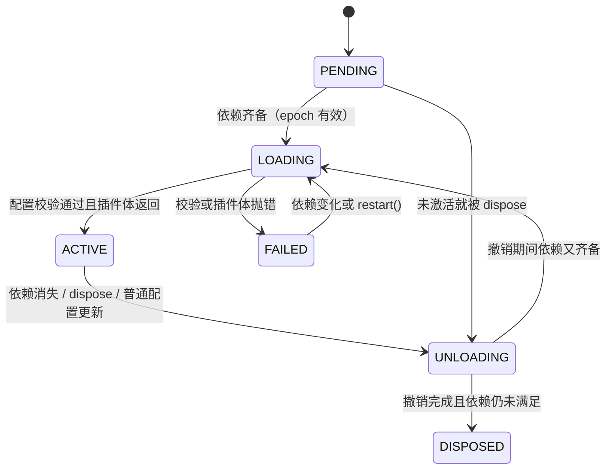
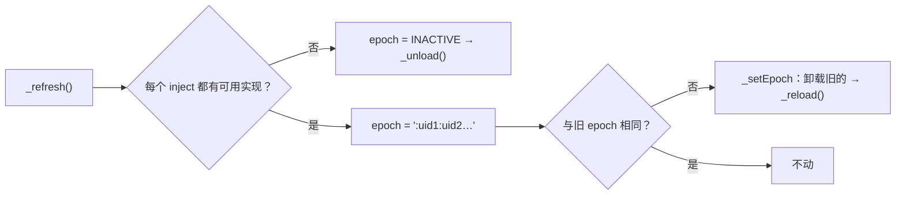
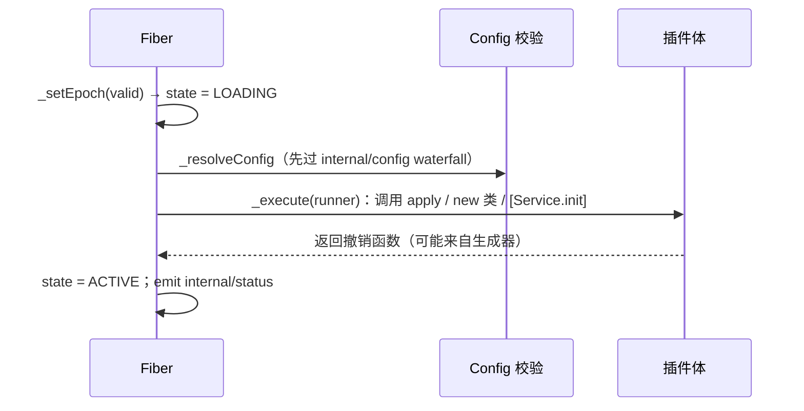
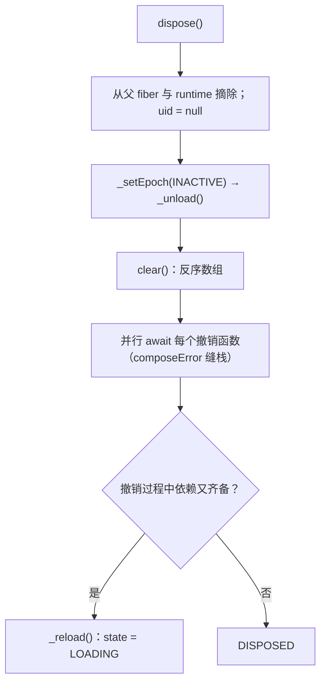

# Fiber：作者如何把生命周期做成一条可撤销的因果链

总纲见 [cordis-design.md](cordis-design.md)。本文按作者的设计顺序展开：为什么插件需要一个"实例"对象、它承担哪些
职责、使用者被期望怎样对待它，以及 TypeScript 在其中解决了哪些表达问题。

## 1 要解决什么问题

### 1.1 场景

一个插件在装载时会注册很多互相独立的资源：监听器、服务、子插件、定时器、连接、watcher。它还会因为外部原因被卸载
或重新装载：依赖换实现、配置更新、热更、父插件被拆。框架必须保证**"注册过的资源一定被收回"**，且收回顺序可预测。

### 1.2 显然做法的代价

| 做法 | 代价 |
|---|---|
| 插件写 `start()` / `stop()` | 作者要维护对称性；多注册点、异步清理时极易遗漏 |
| `dispose()` 接口（对象实现方法） | 每个注册点都要构造一个对象；组合与嵌套时麻烦 |
| TC39 显式资源管理（`using` / `Symbol.dispose`） | 生命周期绑定词法作用域，无法覆盖"运行期产生的多项登记"，也无法统一 await |
| 事件订阅各自带取消函数，作者自行记录 | 与上一条相同：回收责任回到作者身上 |

作者的答案是：**注册动作统一返回撤销函数**，由 fiber 收集并按逆序执行（[fiber.ts:418](sources/deepseek-harness/vendor/cordis/src/fiber.ts#L418)<!-- doctidex: {cross-boundary-point: sources/deepseek-harness} -->）。这也解释了为什么
`ctx.on`、`ctx.provide`、`ctx.plugin` 全都最终调用 `fiber.effect(...)`——它们是同一条通道的入口封装。

### 1.3 需求清单

| 需求 | 对应设计 |
|---|---|
| 任意注册都能撤销 | `Disposable<T>` 返回类型；`_disposables` 栈 |
| 撤销顺序可预测 | 后进先出；子先于父 |
| 支持异步清理 | 撤销函数可返回 Promise，`dispose()` 会等 |
| 依赖变化自动起停 | epoch 比较（§2.3） |
| 重入安全 | 状态机 + `inertia` |
| 可观测 | `getEffects()` 的 effect 树、`internal/status` 事件 |

## 2 作者构建的模型（artifact）

### 2.1 两级对象：runtime 与 fiber

`runtime` 是"同一个插件 callback"的共享记录（名字、配置 schema、所有实例），fiber 是**一次挂载**的运行实例
（[registry.ts:136](sources/deepseek-harness/vendor/cordis/src/registry.ts#L136)<!-- doctidex: {cross-boundary-point: sources/deepseek-harness} -->、
[fiber.ts:184](sources/deepseek-harness/vendor/cordis/src/fiber.ts#L184)<!-- doctidex: {cross-boundary-point: sources/deepseek-harness} -->）。同一个插件挂两次就有两个 fiber：各自一套服务与副作用，互不干扰。

### 2.2 状态机



状态不是自由赋值，而是由 `_getState()`（看 uid / 错误 / epoch）与 `_setEpoch()`（决定启动卸载还是重载）推出来的
（[fiber.ts:625](sources/deepseek-harness/vendor/cordis/src/fiber.ts#L625)<!-- doctidex: {cross-boundary-point: sources/deepseek-harness} -->）。

> **Changed in `dsh-v0.2.1-rc.3`**（相对历史参考版本 `dsh-v0.1.5-rc.2`）：引入 volatile 配置——仅含 volatile 引用的配置变化由
> loader 原地提交，不再触发卸载/重载；`Fiber.update()` 也不再返回 `internal/update` waterfall 的结果。
>
> 历史参考版本的实现见 [fiber.ts:748](sources/deepseek-harness-v0.1.5-rc.2/vendor/cordis/src/fiber.ts#L748)<!-- doctidex: {cross-boundary-point: sources/deepseek-harness-v0.1.5-rc.2} -->。

### 2.3 epoch：把"依赖是谁提供的"编码成字符串

`_refresh()`（[fiber.ts:611](sources/deepseek-harness/vendor/cordis/src/fiber.ts#L611)<!-- doctidex: {cross-boundary-point: sources/deepseek-harness} -->）遍历 inject 的每个名字：缺失 → `INACTIVE`；齐备 → 把每个实现所属 fiber 的 `uid`
拼成字符串。于是"依赖变化"退化成一次字符串比较，而"换实现"（新的提供者 fiber）必然导致字符串变化。



### 2.4 effect 栈与在途转换

| 字段 | 位置 | 作用 |
|---|---|---|
| `uid` | [fiber.ts:186](sources/deepseek-harness/vendor/cordis/src/fiber.ts#L186)<!-- doctidex: {cross-boundary-point: sources/deepseek-harness} --> | 实例身份；也用于 epoch 与"是否已销毁" |
| `store` | [fiber.ts:198](sources/deepseek-harness/vendor/cordis/src/fiber.ts#L198)<!-- doctidex: {cross-boundary-point: sources/deepseek-harness} --> | 本 fiber 已确认可用的服务快照，供解析快速路径 |
| `inertia` | [fiber.ts:200](sources/deepseek-harness/vendor/cordis/src/fiber.ts#L200)<!-- doctidex: {cross-boundary-point: sources/deepseek-harness} --> | 当前在途的卸载/重载 Promise，`await()` 等它结算 |
| `_disposables` | [fiber.ts:203](sources/deepseek-harness/vendor/cordis/src/fiber.ts#L203)<!-- doctidex: {cross-boundary-point: sources/deepseek-harness} --> | 本 fiber 当前登记的撤销函数（后进先出） |

### 2.5 四条不变量

1. 同一 fiber 内后登记先撤销（`DisposableList.clear()` 返回反序数组）。
2. 跨 fiber 时子先于父（子 fiber 的 disposer 本身就是父 fiber 的一条 effect，[fiber.ts:265](sources/deepseek-harness/vendor/cordis/src/fiber.ts#L265)<!-- doctidex: {cross-boundary-point: sources/deepseek-harness} -->）。
3. `dispose()` 幂等；`DISPOSED` 后再使用抛 `INACTIVE_EFFECT`。
4. `UNLOADING` 期间拒绝新登记（`PENDING`/`LOADING` 期间允许）。

## 3 期望的使用方式（心智模型）

### 3.1 插件作者：只写注册，不写清理

作者希望使用者形成"**我描述要发生什么，框架负责什么时候收回**"的直觉。两种等价写法：

```ts
// 单条注册
ctx.effect(() => {
  const timer = setInterval(tick, 1000)
  return () => clearInterval(timer)
})

// 一批注册：用生成器逐个产出
ctx.effect(function* () {
  yield disposeA
  yield disposeB
})
```

### 3.2 把"会被重载"当成常态

依赖换实现、普通配置更新、热更都会让插件体重新执行。作者在教程里把这件事作为基本假设（[docs/cordis-tutorial/02-lifecycle-and-effects.md](sources/deepseek-harness/docs/cordis-tutorial/02-lifecycle-and-effects.md)<!-- doctidex: {cross-boundary-point: sources/deepseek-harness} -->），
因此插件体必须是**可重复执行的**：不要在模块作用域缓存"一次性"状态，也不要假设 `apply` 只会执行一次。

> **Changed in `dsh-v0.2.1-rc.3`**（相对历史参考版本 `dsh-v0.1.5-rc.2`）：loader 增加 volatile-only 原地提交路径
> （`loader/volatile-update`）；此前配置变化会经 `Entry.update()` 触发 fiber 重载。
>
> 历史参考版本的更新入口见 [entry.ts:142](sources/deepseek-harness-v0.1.5-rc.2/vendor/loader/src/config/entry.ts#L142)<!-- doctidex: {cross-boundary-point: sources/deepseek-harness-v0.1.5-rc.2} -->。

### 3.3 两处可等待的时机

`await ctx.plugin(P)` 等到启动完成（配置校验失败会在这里抛）；`await fiber.dispose()` 等到全部清理完成
（[fiber.ts:704](sources/deepseek-harness/vendor/cordis/src/fiber.ts#L704)<!-- doctidex: {cross-boundary-point: sources/deepseek-harness} -->、[fiber.ts:718](sources/deepseek-harness/vendor/cordis/src/fiber.ts#L718)<!-- doctidex: {cross-boundary-point: sources/deepseek-harness} -->）。这两个 await 是使用者唯一需要掌握的"同步点"。

### 3.4 什么时候必须用 `ctx.effect`

框架自带 API（`ctx.on`、`ctx.provide`、`ctx.plugin`）已经是 effect；只有**自建资源**（timer、连接、watcher、
第三方订阅）需要显式包一层。


### 3.5 示例：五种登记方式与两处同步点

```ts
// ① 单条资源：执行体返回撤销函数
ctx.effect(() => {
  const socket = connect(url)
  return () => socket.close()
})

// ② 一批资源：生成器逐个产出，撤销顺序与产出顺序相反
ctx.effect(function* () {
  yield () => cache.clear()
  yield () => index.close()
})

// ③ 异步清理：返回 Promise，dispose() 会等它结束
ctx.effect(async () => {
  const conn = await open()
  return async () => {
    await conn.drain()
    conn.close()
  }
})

// ④ 类插件的异步初始化：构造函数保持同步，准备过程放进 [Service.init]
export class Store extends Service {
  constructor(ctx: Context) { super(ctx, 'store') }

  async* [Service.init]() {
    yield () => this.db.close()     // 先登记撤销
    await this.db.open()            // 再做异步准备
  }
}

// ⑤ 两处可等待的时机
const fiber = ctx.plugin(Store)
await fiber.await()                 // 等启动完成；配置校验失败在这里抛出
await fiber.dispose()               // 等全部清理完成
```

要点：插件体只负责「注册」，撤销顺序由 fiber 决定；由于依赖变化、普通配置更新、热更都会导致重新装载（volatile-only 配置由 loader 原地提交），`apply` 与
`[Service.init]` 都必须可重复执行。写法取自 dsh 教程：

- [docs/cordis-tutorial/02-lifecycle-and-effects.md](sources/deepseek-harness/docs/cordis-tutorial/02-lifecycle-and-effects.md)<!-- doctidex: {cross-boundary-point: sources/deepseek-harness} -->

## 4 用 TypeScript 表达这套设计：作者遇到的问题与解法

### 4.1 撤销的来源必须统一，否则使用者要学多种清理写法

自建资源（timer、连接、watcher）、框架注册（监听器、服务、子插件）、异步准备（打开数据库之后才知道怎么关）在写法上完全不同。作者不打算让使用者记多套 API，于是选了一个很轻的统一表示：**执行体返回撤销函数**，并把"一批"也纳入语言已有的可迭代协议：

```ts
type Effect<T> = Disposable<T> | Iterable<Disposable<T>> | Promise<Disposable<T>> | AsyncIterable<Disposable<T>>
```

收益是使用者可以写生成器逐条登记、框架负责收集与逆序执行；代价是运行时必须做形状判定（`_execute` 的分派），类型上也只表达"可能是这四种"。

### 4.2 为什么不直接用 `using` / `Symbol.dispose`

TC39 的显式资源管理看起来正为这类场景设计，但它绑定**词法作用域**：资源在离开作用域时释放。Cordis 需要的语义不同——撤销发生在"插件被卸载"这一刻，而插件体可能早已返回；并且一次插件执行会产生**数量不定**的登记（循环里注册的工具、动态挂载的子插件）。因此作者自建 effect 协议，而不是复用 `using`。

### 4.3 撤销句柄要既能直接调用，又能 await

`ctx.effect()` 的返回值有两种用法：立刻撤销（`dispose()`）与等待清理完成（`await dispose()`）。TypeScript 里能同时描述两种形态的只有"可调用加 thenable"的接口：

```ts
interface AsyncDisposable<T extends Awaitable<void> = Awaitable<void>> extends PromiseLike<() => T> { (): T }
```

配合 `effect()` 的两个重载（同步 effect 与异步 effect 返回不同类型的撤销句柄），使用者不必再记一套 `disposeAsync` 命名。

### 4.4 "依赖变了要不要重载"需要一个可比较的表示

依赖是服务，而服务会在运行期被替换。作者把"当前这批依赖由谁提供"编码成字符串：把每个依赖实现所属 fiber 的 `uid` 拼起来，变化就重载。选择 `uid` 而不是版本号，是因为要捕捉的语义是"由哪个实例提供"，而不是"值变了没有"——提供者被替换或消失都自动包含在内，也不需要使用者维护版本字段。

### 4.5 状态既要被内部频繁比较，又要对外可观测

fiber 状态被框架高频比较，同时又要出现在诊断面板与日志里。作者用 `const enum FiberState`：编译期内联成数字、运行时不产生对象；状态变化再通过 `internal/status` 广播，外部看到的是同一套枚举。

### 4.6 撤销栈的数据结构受类型约束

撤销函数集合要"按登记顺序入栈、反序取出、还能按值删除"。作者用 `Map` 保序、`WeakMap` 记位置（`DisposableList<T extends WeakKey>`），`WeakKey` 约束让类型系统拒绝用原始值当键——这里类型系统真正帮上了忙，把运行时的诡异行为提前成编译期错误。

### 4.7 类型补不上的那块：错误定位

插件体没有静态调用点，报错只指框架内部就没有意义。这件事类型系统完全帮不上，只能靠运行时缝合堆栈（`composeError` 与 `getOuterStack`）。它提醒读者：这套设计里有一部分契约（撤销顺序、错误归属）只能由实现与文档共同保证，而不是靠类型推导。

## 5 机制精读

### 5.1 装载：`_reload()` 里做三件事

先等一个微任务检查点（期间可能已被其它路径失效），再解析配置（`_resolveConfig`，此时依赖已就绪）、再执行插件体并
收集撤销函数；失败则记录 `_error` 并把 epoch 打回 `INACTIVE`（[fiber.ts:646](sources/deepseek-harness/vendor/cordis/src/fiber.ts#L646)<!-- doctidex: {cross-boundary-point: sources/deepseek-harness} -->）。



### 5.2 卸载：逆序、等待、可重入



`_unload()`（[fiber.ts:675](sources/deepseek-harness/vendor/cordis/src/fiber.ts#L675)<!-- doctidex: {cross-boundary-point: sources/deepseek-harness} -->）对每个撤销函数单独 try/catch，一个失败不会阻断其它清理——"拆干净"优先于"报第一个错"。

### 5.3 重入：`inertia` 与三处加固

卸载可以被另一条路径打断（父级先拆、依赖同时在变、观察者在 `internal/plugin` 里直接 dispose），所以 fiber 用
`inertia` 记录在途转换，`await()` 循环等它结算（[fiber.ts:704](sources/deepseek-harness/vendor/cordis/src/fiber.ts#L704)<!-- doctidex: {cross-boundary-point: sources/deepseek-harness} -->）。dsh 在引入副本里额外加固了三处
（[vendor/README.md](sources/deepseek-harness/vendor/README.md)<!-- doctidex: {cross-boundary-point: sources/deepseek-harness} --> 本地修改第 6 条）：effect 的 owner 包装先于执行体注册、同步失败要回滚已收集的清理、
`UNLOADING` 期间拒绝创建新 effect。这三处说明一个现实：**可撤销性在重入时序下不是自动成立的**，需要实现者持续
补边界。

### 5.4 错误定位：把配置行缝进堆栈

插件体没有静态调用点。`composeError()`（
[utils.ts:268](sources/deepseek-harness/vendor/cordis/src/utils.ts#L268)<!-- doctidex: {cross-boundary-point: sources/deepseek-harness} -->）与 `buildOuterStack()`（
[utils.ts:284](sources/deepseek-harness/vendor/cordis/src/utils.ts#L284)<!-- doctidex: {cross-boundary-point: sources/deepseek-harness} -->）把外层调用栈拼进
内层错误的堆栈；加载器提供的 `getOuterStack` 生成 `at <baseUrl>#<entry-id>` 形式的位置
（[vendor/loader/src/config/entry.ts:199](sources/deepseek-harness/vendor/loader/src/config/entry.ts#L199)<!-- doctidex: {cross-boundary-point: sources/deepseek-harness} -->）。因此插件抛错时，堆栈里出现的是配置文件里的那一行。

## 6 难点与晦涩点

### 6.1 `PENDING` 的 fiber 也可能持有副作用

直觉上"没激活就没有副作用"，但 `internal/plugin` 的观察者可以在激活前就向这个 fiber 登记内容。于是卸载路径必须
能排空"未激活期间攒下的登记"，这也是 §5.3 里那几处加固存在的原因。

### 6.2 为什么用"依赖实现的 fiber uid"而不是值的版本号

因为要捕捉的语义是"**这个依赖现在由谁提供**"。用 uid 可以自动覆盖"提供者被替换"（新 fiber、新 uid）与"提供者
消失"（无实现 → INACTIVE）两种情况；而值层面的版本号既需要使用者维护，又无法表达"换成另一个实现"。

### 6.3 为什么配置解析推迟到依赖齐备之后

配置里可能有 `!!js` 表达式（loader 的行内表达式），它可能读服务。若在 PENDING 阶段解析，读服务会失败。作者把
`_resolveConfig` 放进 `_reload()`（[fiber.ts:646](sources/deepseek-harness/vendor/cordis/src/fiber.ts#L646)<!-- doctidex: {cross-boundary-point: sources/deepseek-harness} -->）——这也是加载器"惰性解析"能成立的前提。

### 6.4 `store` 与 `_store` 的区别

`_store` 是 fiber 自己维护的完整快照，`store` 是它在 ACTIVE 时对外暴露的副本。读代码时容易把两者混为一谈；
记住"对外的 store 只在活跃期有值"即可。

## 7 为什么不是别的做法

| 做法 | 代价 | 作者的选择（推断） |
|---|---|---|
| `start/stop` 对称 API | 使用者要维护对称性；遗漏即泄漏 | 返回撤销函数，框架逆序执行 |
| `Symbol.dispose` / `using` | 只能表达词法作用域内的资源；无法收集运行期批量登记 | 自建 effect 协议（含生成器与异步迭代器） |
| 依赖变化时只重启"受影响的注册" | 需要细粒度依赖图，复杂度远超收益 | 整 fiber 卸载 + 重载，语义简单可预测 |
| 用版本号判断依赖是否变化 | 使用者要维护版本；无法表达"换实现" | epoch = 提供者 fiber 的 uid |
| 卸载时顺序执行所有清理并遇错即停 | 一个坏清理会让其余资源泄漏 | 并行清理、逐个容错 |

## 8 未验证

重入场景的完整矩阵（父级先拆、观察者强制 dispose、依赖与配置同时变化）只读了实现与本地修改清单，未做实验；
`inertia` 链在高并发挂载下的表现未测量；`store`/`_store` 在解析路径上的确切差异未逐行验证。

## 9 来源

- 引入副本（tag `dsh-v0.2.1-rc.3`）：[sources/deepseek-harness](sources/deepseek-harness)<!-- doctidex: {cross-boundary-point: sources/deepseek-harness} -->
  - 本文引用的文件：
    - [vendor/cordis/src/fiber.ts](sources/deepseek-harness/vendor/cordis/src/fiber.ts)<!-- doctidex: {cross-boundary-point: sources/deepseek-harness} -->
    - [utils.ts](sources/deepseek-harness/vendor/cordis/src/utils.ts)<!-- doctidex: {cross-boundary-point: sources/deepseek-harness} -->
    - [vendor/loader/src/config/entry.ts](sources/deepseek-harness/vendor/loader/src/config/entry.ts)<!-- doctidex: {cross-boundary-point: sources/deepseek-harness} -->
    - [docs/cordis-tutorial/02-lifecycle-and-effects.md](sources/deepseek-harness/docs/cordis-tutorial/02-lifecycle-and-effects.md)<!-- doctidex: {cross-boundary-point: sources/deepseek-harness} -->
