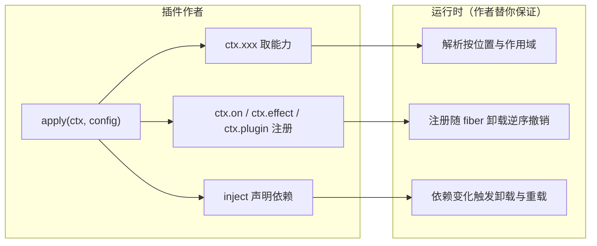

# 编程模型：作者要求使用者遵守的约定

总纲见 [cordis-design.md](cordis-design.md)。本文把散落在各篇里的"约定"集中起来：作者要求使用者以什么方式写代码、为什么必须这样、
违反之后会发生什么、以及哪条机制在兜底。约定不是风格建议——它们直接决定框架能不能兑现"可撤销、可替换、可组合"这三件事。

## 1 编程模型是什么

### 1.1 三条承诺

| 承诺 | 使用者看到的样子 | 背后的机制 |
|---|---|---|
| 环境即上下文 | 一切能力都从 `ctx`（或服务方法里的 `this.ctx`）上取，不 import 具体实现 | Context 的按名解析（[cordis-context.md](cordis-context.md)） |
| 注册即效果 | 只写"注册什么"，不写清理；卸载时按逆序自动撤销 | Fiber 的 effect 协议（[cordis-fiber.md](cordis-fiber.md)） |
| 依赖即声明 | 写 `inject`，不写启动顺序；依赖变化时自动卸载与重载 | 服务的可用性与通知（[cordis-service.md](cordis-service.md)） |

### 1.2 使用者看到的世界



### 1.3 与论文概念的对应

论文把两个维度分别叫 revertible effect（时间）与 reactive coeffect（空间），并统一到 context 上。编程模型就是这套理论对使用者的投影：
**"注册即效果"对应前者，"依赖即声明"对应后者，"环境即上下文"是把两者合并后暴露给使用者的唯一入口。**

## 2 约定清单

下表是作者要求使用者遵守的约定。每条都给出原因、违反后的现象，以及框架里在兜底的机制。

| # | 约定 | 为什么 | 违反后的现象 | 兜底机制 |
|---|---|---|---|---|
| 1 | 访问环境一律走 `ctx`（服务里走 `this.ctx`），不要用模块级变量保存上下文 | 环境是运行时的、按位置解析的；模块级单例无法表达"每个插件不同" | 拿到的服务属于别的插件作用域，或依赖变化后仍指向旧实现 | 解析按 fiber 链与隔离标签进行（[cordis-context.md](cordis-context.md)） |
| 2 | 不要把 `ctx`（尤其是服务方法里的 `this.ctx`）保存起来跨调用使用 | 方法里的 `this.ctx` 是一次调用的临时把手（shadow），它携带的是那次调用的归属 | 后续调用拿到的是**第一次调用者**的上下文 | 无强制；见 [cordis-traceable.md](cordis-traceable.md) §6.5 |
| 3 | 注册类操作都返回撤销函数；自建资源必须包 `ctx.effect` | 卸载的唯一依据是 fiber 上登记的撤销函数 | 资源泄漏：插件卸载后定时器仍在跑、监听器仍在响应 | 框架 API 自带（`on` / `provide` / `plugin`），自建资源需显式登记（[cordis-fiber.md](cordis-fiber.md)） |
| 4 | 需要别的能力就写 `inject`；`ctx.get(name, false)` 只作逃生门 | 依赖要可声明、可推导，才能参与激活与重载 | 依赖缺失时不是等待而是报错，或拿到未激活的实现 | 解析失败会抛错并区分"未声明"与"未激活"（[cordis-context.md](cordis-context.md) §4.3） |
| 5 | 插件体必须可重复执行 | 依赖换实现、普通配置更新、热更都会导致重新装载（volatile-only 配置由 loader 原地提交） | 第二次装载出现重复注册、状态错乱 | 框架保证卸载干净；幂等由插件作者负责（[cordis-fiber.md](cordis-fiber.md)） |
| 6 | 服务是单例：共享状态的一致性由服务自己负责 | 框架只保证"归属视角"，不保证"状态隔离" | 以为写入会隔离，实际写到了共享实例上 | 无强制；`ctx.isolate` 只能隔离**实现选择**，不隔离状态（[cordis-traceable.md](cordis-traceable.md) §5.5） |
| 7 | 监听器只用 `on` / `once` 注册；派发属于声明该事件的生产者 | 模式是事件契约的一部分，派发点必须唯一 | 自己派发 `internal/*` 会破坏框架的自省语义 | `@mode` 标签加生成器校验（[cordis-events.md](cordis-events.md)） |
| 8 | 扩展框架优先用 `internal/*` 与声明合并，而不是改核心 | 框架自身也是插件集合，"没有特权内核" | 分叉核心后无法跟随上游，热更与校验也会失效 | 内部事件与 `Service` 协议点（[cordis-events.md](cordis-events.md)、[cordis-service.md](cordis-service.md)） |

> **Changed in `dsh-v0.2.1-rc.3`**（相对历史参考版本 `dsh-v0.1.5-rc.2`）：约定 5 的"配置更新"有了 volatile-only 例外——
> 此类变化由 loader 原地提交，不触发重新装载。
>
> 历史参考版本的更新入口见 [entry.ts:142](sources/deepseek-harness-v0.1.5-rc.2/vendor/loader/src/config/entry.ts#L142)<!-- doctidex: {cross-boundary-point: sources/deepseek-harness-v0.1.5-rc.2} -->。

## 3 约定背后的机制

约定与机制的对应关系可以反过来读：**每一条约定，都是某个机制把复杂度从使用者转移到框架的结果**。

| 约定 | 由哪个机制兑现 |
|---|---|
| 1 环境即上下文 | Proxy 解析（`get` / `set` 陷阱）、fiber 链上溯、隔离标签 |
| 2 不保存 `ctx` | shadow 与 `[symbols.shadow]` 指针；`getTraceable` 的剥离 |
| 3 注册即撤销 | `fiber.effect()`、`_disposables` 栈、逆序执行 |
| 4 依赖即声明 | `provide` / `inject` / `notify` / `check` 谓词 |
| 5 可重复执行 | 依赖变化触发的整实例卸载与重载（epoch 比较） |
| 6 单例不隔离状态 | 单实例 + 按调用方重绑定（归属与状态分离） |
| 7 派发唯一 | 事件模式契约 + `internal/*` 只读约定 |
| 8 不 fork 核心 | 内部事件、服务协议点、声明合并 |

## 4 三个最容易误读的边界

### 4.1 case：`this.ctx` 不是"我的上下文"

服务方法里的 `this.ctx` 是**调用方上下文的派生加一个指向服务自身上下文的指针**。因此同一个对象上，两类读取的路径不同：读服务按提供者自己的链解析，注册副作用记在调用方账上。
反例：以为 `this.ctx` 就是"我（服务）的上下文"，于是把调用方私有的服务当成自己可见的服务——只有当调用方本来就在你的祖先链上时才成立。

### 4.2 case：`ctx.foo` 是解析，不是取字段

`ctx.foo` 在插件上下文里是一次依赖解析：没声明过会抛 `cannot get property … without inject`，声明了但提供者未激活会抛 `cannot get required service … in inactive context`。想要"取不到就返回 undefined"必须显式写 `ctx.get('foo', false)`，并接受失去依赖保护。
反例：用 `if (ctx.foo)` 探测依赖是否存在——它不是探测，是断言。

### 4.3 case：单例服务加多调用方

服务是单例：所有调用方共享同一份实例状态；框架重绑定的只是**归属视角**，不是状态。所以：
```ts
class Counter extends Service {
  count = 0                      // 共享：所有调用方看到同一个数
  bump() { this.count++ }        // 写入落在实例上（见 cordis-traceable §5.5）
}
```
如果确实需要"每个使用者一份状态"，正确做法是用 `ctx.isolate(...)` 挂两份实现，而不是指望调用方之间互不干扰。

## 5 未验证

约定 2 的违规后果（保存 shadow 跨调用）是按代码语义推导的，未做运行验证；约定 6 的"写入落在实例上"同样只做了代码推导（需要装好依赖的环境才能跑探针）。

## 6 来源

- 引入副本（tag `dsh-v0.2.1-rc.3`）：[sources/deepseek-harness](sources/deepseek-harness)<!-- doctidex: {cross-boundary-point: sources/deepseek-harness} -->
  - 本文引用的文件：`vendor/cordis/src/{context,reflect,service,fiber,utils}.ts`、`docs/cordis-primer.md`
