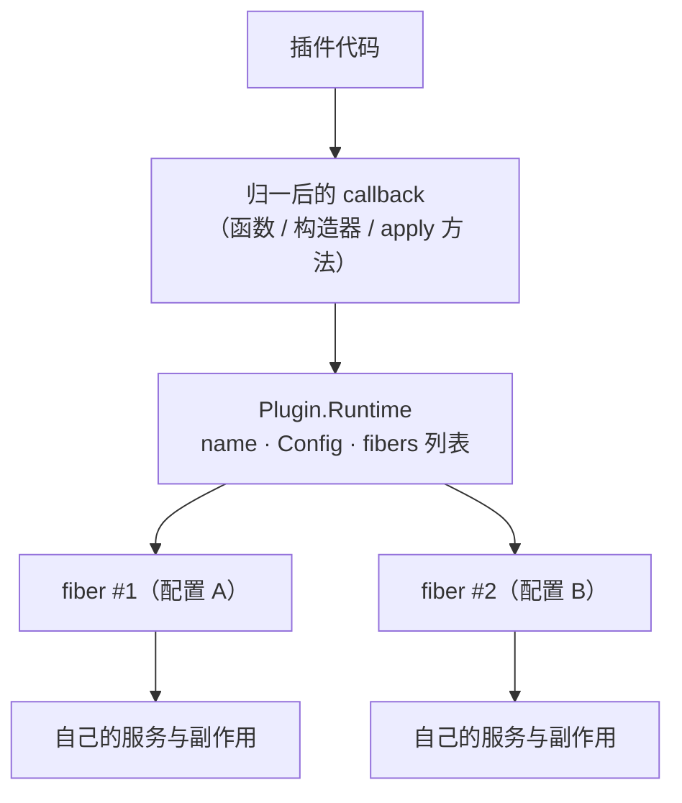
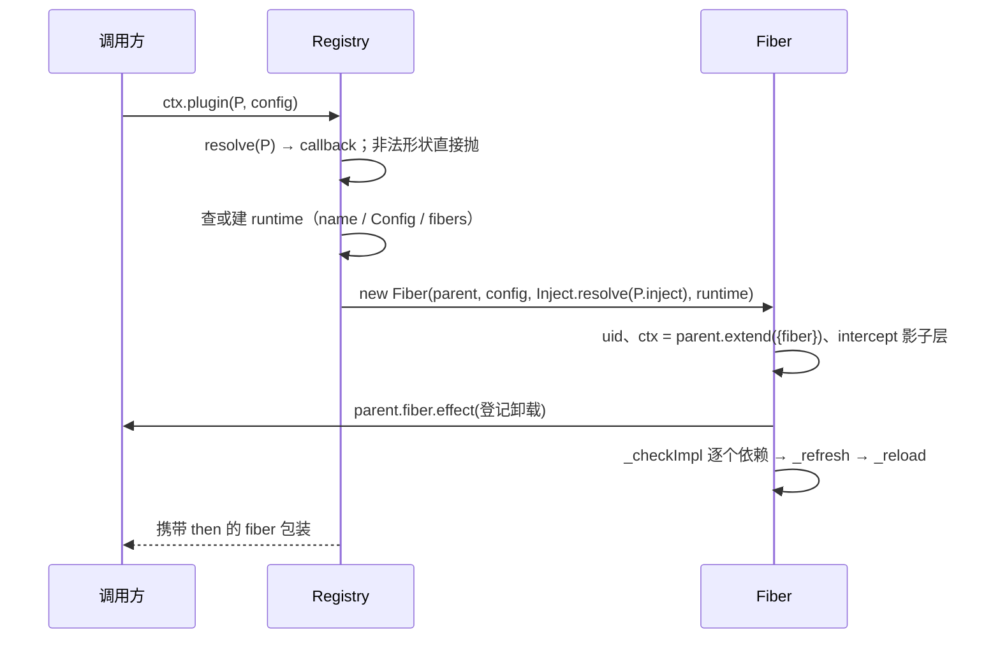

# Registry：作者如何定义"插件"这个对象

总纲见 [cordis-design.md](cordis-design.md)。本文按作者的设计顺序展开：插件这个概念要容纳哪些写法、注册表在运行时
维护什么、使用者被期望怎样挂载与等待，以及 TypeScript 如何把"三种形状一个入口"这件事推导出来。

## 1 要解决什么问题

### 1.1 场景

生态里的插件天然分三类：直接写的函数（`export function apply(ctx) {}`）、有状态或有继承关系的类、以及包一层
第三方库的 `{ apply }` 对象。如果框架只接受一种，生态里就会到处是适配器；如果三种各走一套挂载 API，使用者又要
学三遍，注册表也无法统一回答"这个插件现在挂了几个实例"。

### 1.2 显然做法的代价

| 做法 | 代价 |
|---|---|
| 只支持函数插件 | 有状态插件只能写成闭包；类继承、`instanceof`、装饰器都用不上 |
| 只支持类插件 | 简单插件被强制套壳；模块命名空间写法（`export const inject = [...]`）无法直接挂载 |
| 为每种形状提供不同 API | 使用者的心智分裂；运行时也无法统一记录同一插件的多实例状态 |
| 把配置校验交给插件自己 | 校验时机不统一（有的在构造里、有的在 `apply` 里），错误信息风格各异 |

作者的解法是：**三种形状在入口处归一到同一个函数**，注册表以这个函数为键；元数据（名字、配置 schema、依赖声明）
始终从传进来的插件对象上读。

### 1.3 需求清单

| 需求 | 对应设计 |
|---|---|
| 三种写法等价 | `resolve()` 归一（[registry.ts:222](sources/deepseek-harness/vendor/cordis/src/registry.ts#L222)<!-- doctidex: {cross-boundary-point: sources/deepseek-harness} -->） |
| 同一插件可挂多次 | runtime（共享）与 fiber（每实例一个）两级结构 |
| 挂载即可等待 | 返回 `Fiber & PromiseLike<Fiber>` |
| 配置校验统一 | standard-schema 协议 + `ValidationError` |
| 依赖声明可写在类上 | `@Inject` 装饰器（类级 / 方法级） |
| 类型可推导 | 条件类型 + 可变元组（§4） |

## 2 作者构建的模型（artifact）

### 2.1 两级结构



| 概念 | 位置 | 含义 |
|---|---|---|
| 插件元数据 | `Plugin.Base`（[registry.ts:98](sources/deepseek-harness/vendor/cordis/src/registry.ts#L98)<!-- doctidex: {cross-boundary-point: sources/deepseek-harness} -->） | `name` / `Config` / `inject` / `provide` / `intercept` |
| 三种形状 | [registry.ts:106](sources/deepseek-harness/vendor/cordis/src/registry.ts#L106)<!-- doctidex: {cross-boundary-point: sources/deepseek-harness} --> 起 | 函数 / 构造器 / `{ apply }` |
| 共享记录 | `Plugin.Runtime`（[registry.ts:136](sources/deepseek-harness/vendor/cordis/src/registry.ts#L136)<!-- doctidex: {cross-boundary-point: sources/deepseek-harness} -->） | 一个 callback 的名字、schema 与全部实例 |
| 注册表 | [registry.ts:196](sources/deepseek-harness/vendor/cordis/src/registry.ts#L196)<!-- doctidex: {cross-boundary-point: sources/deepseek-harness} --> | callback → runtime，进程内一份 |
| 实例 | `Fiber` | 每次 `ctx.plugin()` 产生一个 |

### 2.2 两条不变量

1. 同一个 callback 的多次挂载共享 runtime 记录，但**各自拥有独立的 ctx、服务与副作用**。
2. `registry.delete(plugin)` 一次卸载该插件的全部实例（[registry.ts:259](sources/deepseek-harness/vendor/cordis/src/registry.ts#L259)<!-- doctidex: {cross-boundary-point: sources/deepseek-harness} -->）。

## 3 期望的使用方式（心智模型）

### 3.1 插件作者：写最顺的那种形状

```ts
// 1) 函数 + 模块级元数据（dsh 产品侧的主流写法，200 处 export const inject）
export const name = 'my-plugin'
export const inject = ['tools']
export function apply(ctx: Context, config: Config) { … }

// 2) 类（有状态、想用装饰器或继承）
@Inject('tools')
export class MyPlugin { constructor(ctx: Context, config: Config) { … } }

// 3) 对象
export default { name: 'my-plugin', inject: ['tools'], apply(ctx, config) { … } }
```

### 3.2 装配者：挂载点决定作用域

`ctx.plugin(P)` 的 `ctx` 就是作用域：挂在哪里，插件就在哪里的作用域里解析服务。同一个插件挂两次是两套实例，
这正是 dsh "同一个插件按 preset 配两份" 的实现基础。

### 3.3 等待启动：两种写法都要成立

`const fiber = ctx.plugin(P)` 立刻拿到句柄（可 `dispose()`、可作为父级继续挂子插件）；`await ctx.plugin(P)` 等到启动
完成，配置校验失败或插件体抛错会在这里抛出（[registry.ts:330](sources/deepseek-harness/vendor/cordis/src/registry.ts#L330)<!-- doctidex: {cross-boundary-point: sources/deepseek-harness} -->）。作者希望使用者按需要选择，而不是被强制等待。

### 3.4 组合模式：`ctx.inject` 是最小插件的快捷方式

`ctx.inject(['tools'], (ctx) => { … })` 等价于挂一个只含 `inject` 与 `apply` 的匿名插件（[registry.ts:300](sources/deepseek-harness/vendor/cordis/src/registry.ts#L300)<!-- doctidex: {cross-boundary-point: sources/deepseek-harness} -->）。
它的价值是把"临时需要一个依赖"从"新建文件 + 导出元数据"降到一行。


### 3.5 示例：三种形状、带配置挂载、最小插件与装饰器

```ts
// ① 三种插件形状等价
export function apply(ctx: Context) {}                       // 函数
export default { name: 'obj', apply(ctx: Context) {} }       // 对象
export class MyService extends Service {                     // 类
  constructor(ctx: Context) { super(ctx, 'myService') }
}
```

```ts
// ② 带配置挂载：参数类型由插件形状推导，少传／多传都是类型错误
export interface Config { retries: number }
export const Config: Schema<Config> = Schema.object({
  retries: Schema.number().default(3),
})
export function apply(ctx: Context, config: Config) {}

const fiber = ctx.plugin(MyPlugin, { retries: 5 })
await fiber.await()             // 等启动完成；配置校验失败在这里抛出
```

```ts
// ③ 最小插件：ctx.inject 等价于挂一个只含 inject 与 apply 的匿名插件
ctx.inject(['tools'], (ctx) => {
  ctx.tools.register(myTool)
})

// ④ 装饰器：类级声明依赖，方法级把「依赖就绪」下推到单个方法
@Inject('tools')
export class ToolHost {
  constructor(ctx: Context, config: Config) {}

  @Inject('llm')
  onReady() {
    // 只有 llm 可用时才会被调用；依赖消失后本插件卸载，方法不会带着旧依赖继续运行
  }
}
```

要点：三种写法共享同一套语义（一个 callback、每挂载一次一个 fiber）；`inject` 的两种写法（模块导出、装饰器）等价；
配置校验发生在 `apply` 之前。写法取自 dsh 教程：

- [docs/cordis-tutorial/01-first-plugin.md](sources/deepseek-harness/docs/cordis-tutorial/01-first-plugin.md)<!-- doctidex: {cross-boundary-point: sources/deepseek-harness} -->
- [docs/cordis-tutorial/05-config.md](sources/deepseek-harness/docs/cordis-tutorial/05-config.md)<!-- doctidex: {cross-boundary-point: sources/deepseek-harness} -->

## 4 用 TypeScript 表达这套设计：作者遇到的问题与解法

### 4.1 三种插件形状要共存，但注册表只认一件事

函数、类、`{ apply }` 对象在类型上是三种东西，运行时却必须归一到"一个可调用入口"。作者的做法是：类型层用联合描述三种形状（`Plugin.Function | Plugin.Constructor | Plugin.Object`，元数据放在 `Plugin.Base`，用 `namespace` 组织），运行时用 `resolve()` 把三者归一成同一条 callback。
为什么不把两套都保留？因为注册表的账目必须只有一份：同一个插件挂两次要共享一条 runtime 记录。**类型层可以丰富，运行时结构必须唯一**。

### 4.2 `ctx.plugin(P, config)` 的参数要随插件形状变化

有配置的插件必须传配置，没配置的不能多传。用泛型参数做不到（使用者要手写类型参数），于是用条件类型与可变元组推导：

```ts
type Spread<T> = undefined extends T ? [config?: T] : [config: T]
type GetPluginConfig<P> = P extends Plugin.Transform<infer S, any> ? S : GetPluginParameters<P>[0]
```

`undefined extends T` 的写法是为了让"配置可选"精确到**参数本身**，而不是让 `config` 变成 `T | undefined`。

### 4.3 挂载既要能立刻拿到句柄，又要能 await

组织挂载顺序需要句柄，等待启动失败需要 Promise。作者用交叉类型表达"两者都是"：`Fiber & PromiseLike<Fiber>`，运行时对应"用 `Object.create(fiber)` 造一个带 `then` 的包装"。这种"类型上交叉、运行时拼接"的做法，是在不引入新概念的前提下同时满足两种用法。

### 4.4 依赖声明要能写在类上，包括单个方法

函数插件用模块导出的 `inject` 就够了，类插件没有这个位置。作者用 TC39 装饰器补上：类级 `@Inject` 写进 `inject` 的原型链（用 `symbols.checkProto` 标记"沿原型链合并"），方法级 `@Inject` 用 `addInitializer` 把调用推迟到依赖就绪之后。
选择标准装饰器而不是 `experimentalDecorators`，是为了与未来的 JavaScript 保持一致；代价是要处理两种装饰器上下文与初始化时机。

### 4.5 配置校验：接协议，不接库

与 Service 一致：`Config` 的类型是 `StandardSchemaV1`，fiber 只调用协议方法。dsh 因此可以用 schemastery，别处也可以换实现，框架不需要感知具体库。

### 4.6 类型留下的两个缺口

一是"不 await 的挂载"：失败只会把 fiber 标记为 FAILED，类型上看不出来，只有 `await fiber.await()` 才会抛给调用者。二是"同名服务冲突"：只有运行到注册那一刻才发现。两处都不是类型能解决的，作者用错误信息与文档补足。

## 5 机制精读

### 5.1 `ctx.plugin()` 的七步



`Inject.resolve`（[registry.ts:71](sources/deepseek-harness/vendor/cordis/src/registry.ts#L71)<!-- doctidex: {cross-boundary-point: sources/deepseek-harness} -->）负责把数组、对象、以及类装饰器留下的原型链元数据统一成"名字 → 配置"的映射。

### 5.2 runtime 的复用与删除

同一个 callback 的第二次挂载只是向 runtime 的 fiber 列表追加一个实例；`delete()` 会先在注册表里摘除记录，再逐个
dispose 这些 fiber（[registry.ts:259](sources/deepseek-harness/vendor/cordis/src/registry.ts#L259)<!-- doctidex: {cross-boundary-point: sources/deepseek-harness} -->）。fiber 自己的卸载路径也会维护这个列表——两条路径最终一致，这是"注册表与
实例记录不会出现偏差"的保证。

### 5.3 类插件需要异步初始化时

类的构造函数必须同步；需要异步准备的类插件应实现 `[Service.init]` 生成器，fiber 会在构造后调用它，并把产出的
撤销函数收进同一条 effect 通道（[fiber.ts:254-257](sources/deepseek-harness/vendor/cordis/src/fiber.ts#L254)<!-- doctidex: {cross-boundary-point: sources/deepseek-harness} -->）。dsh 里 12 处 `[Service.init]` 都是这个用法。

## 6 难点与晦涩点

### 6.1 元数据读的是"传进来的那个对象"

`resolve()` 取 `plugin.apply` 作为 callback，但 `name` / `Config` / `inject` 仍然从这个对象上读（[registry.ts:320](sources/deepseek-harness/vendor/cordis/src/registry.ts#L320)<!-- doctidex: {cross-boundary-point: sources/deepseek-harness} -->）。
所以模块命名空间对象（`export function apply` + `export const inject`）、带静态字段的函数、类都能用同一条路径——
理解了这一点，就不必为 dsh 里三种写法各准备一份解释。

### 6.2 插件体抛错不会崩进程

插件体抛错把 fiber 置为 FAILED 并记录错误（[fiber.ts:646](sources/deepseek-harness/vendor/cordis/src/fiber.ts#L646)<!-- doctidex: {cross-boundary-point: sources/deepseek-harness} -->），只有 `await ctx.plugin(P)` 或 `fiber.await()` 才会把它
抛给调用者。用"不 await"的写法时，启动失败可能是静默的——这是使用者最容易忽视的问题之一。

### 6.3 同名服务冲突是运行时的

同一个插件挂两次、又都提供 `ctx.x`，第二次注册会抛 "service x has been registered at <fiber>"
（[reflect.ts:289](sources/deepseek-harness/vendor/cordis/src/reflect.ts#L289)<!-- doctidex: {cross-boundary-point: sources/deepseek-harness} -->）。类型系统看不出这件事，需要用 `isolate` 或不同服务名区分（见 [cordis-service.md](cordis-service.md)）。

### 6.4 `Plugin.Transform` 是给"配置要转换"留的口子

某些插件希望对外暴露的配置形态与内部使用的不同（例如把用户写的简写展开）。`Plugin.Transform`（[registry.ts:122](sources/deepseek-harness/vendor/cordis/src/registry.ts#L122)<!-- doctidex: {cross-boundary-point: sources/deepseek-harness} -->）用
`schema: true` 标记这类对象，`GetPluginConfig` 会取用户侧类型 `S` 而不是运行时类型 `T`。本副本里未统计使用面。

## 7 为什么不是别的做法

| 做法 | 代价 | 作者的选择（推断） |
|---|---|---|
| 只接受类插件 | 简单插件要套壳；模块元数据写法无处安放 | 三种形状归一 |
| 每个实例一份 runtime | 无法回答"这个插件挂了几个"，配置 schema 与名字也要重复存 | runtime / fiber 两级 |
| 挂载必须 `await` | 需要句柄组织顺序时很难写 | 返回 thenable，两用 |
| 校验放在插件体里 | 时机与错误风格不统一，失败可能发生在副作用之后 | 激活前统一校验 |
| 依赖声明只允许写在对象字段上 | 类插件要额外写一份 | 类级 / 方法级 `@Inject` + `inject` 原型链合并 |

## 8 未验证

产品侧类插件与函数插件的实际比例（本次只统计到 `extends Service` 107 处、`export const inject` 200 处）；
`Plugin.Transform` 的使用面；`@Inject` 方法级形式在产品里的用例数量。

## 9 来源

- 引入副本（tag `dsh-v0.2.1-rc.3`）：[sources/deepseek-harness](sources/deepseek-harness)<!-- doctidex: {cross-boundary-point: sources/deepseek-harness} -->
  - 本文引用的文件：
    - [vendor/cordis/src/registry.ts](sources/deepseek-harness/vendor/cordis/src/registry.ts)<!-- doctidex: {cross-boundary-point: sources/deepseek-harness} -->
    - [fiber.ts](sources/deepseek-harness/vendor/cordis/src/fiber.ts)<!-- doctidex: {cross-boundary-point: sources/deepseek-harness} -->
    - [reflect.ts](sources/deepseek-harness/vendor/cordis/src/reflect.ts)<!-- doctidex: {cross-boundary-point: sources/deepseek-harness} -->
    - [vendor/schemastery/src/index.ts](sources/deepseek-harness/vendor/schemastery/src/index.ts)<!-- doctidex: {cross-boundary-point: sources/deepseek-harness} -->
