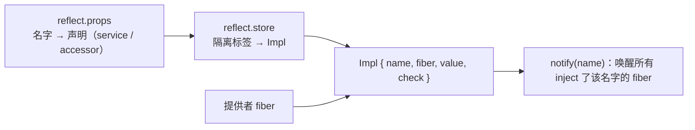
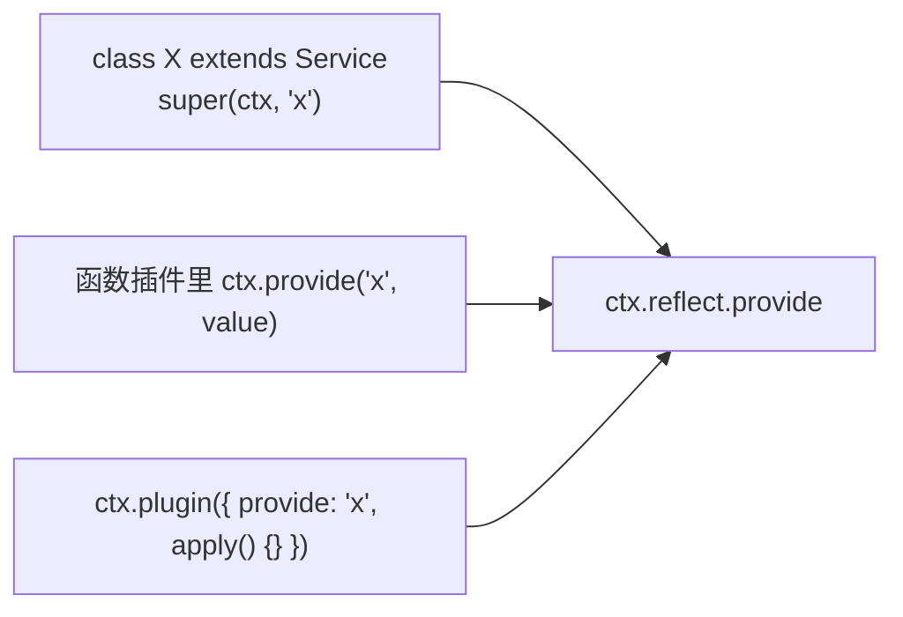
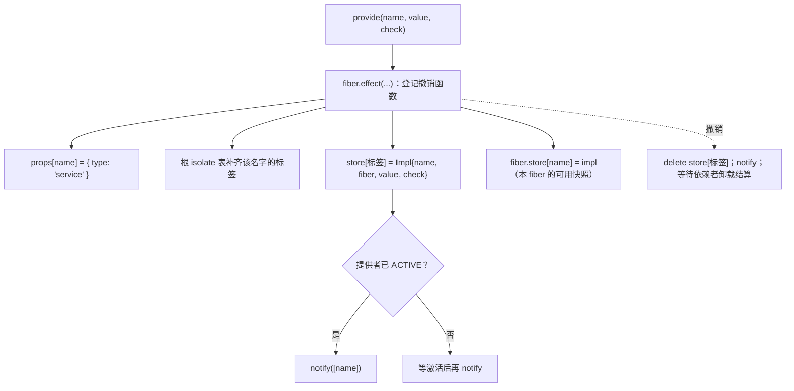

# Service：作者如何把"能力"变成可替换的一等公民

总纲见 [cordis-design.md](cordis-design.md)。本文按作者的设计顺序展开：能力这件事为什么要单独抽象、抽象成什么形状、
希望使用者怎么用，以及 TypeScript 在其中承担了哪些推导。

## 1 要解决什么问题

### 1.1 场景

同一份产品要能按配置换实现：换模型适配器、换工具执行器、换会话存储；同一个能力在不同装配位置还可能要不同实现
（每个 agent 一套 plan 状态）。使用点的代码不应该知道这些差异。

### 1.2 显然做法的代价

| 做法 | 代价 |
|---|---|
| 使用点 import 具体实现 | 替换要改代码；无法按配置分叉；测试要全局替换 |
| 全局单例 + 初始化函数 | 无法表达"暂时不可用"；无法按作用域隔离；卸载无从谈起 |
| 只提供 `ctx.get/set` 式注册表 | 使用点要处理"还没有"，类型靠手写；没有存活期概念 |

作者要的形态是：**提供一个能力 = 挂一个插件**，于是"替换能力"自动变成"卸载旧的 + 挂载新的"，而卸载早已由 Fiber
的生命周期机制保证（[cordis-fiber.md](cordis-fiber.md)）。

### 1.3 需求清单

| 需求 | 对应设计 |
|---|---|
| 按名提供、按名消费 | `ctx.provide` / `inject` |
| 存活期与插件一致 | 注册即 effect |
| 可表达"存在但当前不可用" | 可用性谓词 `check` |
| 可被上层配置覆盖 | intercept（服务配置） |
| 形态可扩展（对象/可调用/派生） | `invoke` / `extend` / `filter` 协议点 |
| 类型可推导 | 声明合并 + 幻影配置类型 |

## 2 作者构建的模型（artifact）

### 2.1 服务 = 一个类 + 七个协议点

`Service` 是一个抽象类，子类在构造函数里 `super(ctx, 'name')` 即完成注册（[service.ts:57](sources/deepseek-harness/vendor/cordis/src/service.ts#L57)<!-- doctidex: {cross-boundary-point: sources/deepseek-harness} -->）。它把"能力"拆成七个
可选的协议点，全部用符号表达（[service.ts:13-25](sources/deepseek-harness/vendor/cordis/src/service.ts#L13)<!-- doctidex: {cross-boundary-point: sources/deepseek-harness} -->）：

| 协议点 | 谁实现 | 作用 |
|---|---|---|
| `[Service.init]` | 服务/插件类 | 构造之后的异步初始化，返回的撤销函数进入 fiber 的撤销栈 |
| `[Service.check]` | 服务 | 可用性谓词，决定依赖者此刻能否激活 |
| `[Service.config]` | 服务（类型层） | 幻影成员，声明该服务的配置类型 |
| `[Service.invoke]` | 服务 | 让服务实例同时可调用（`ctx.logger('name')`） |
| `[Service.extend]` | 服务 | 从现有实例派生新实例 |
| `[Service.tracker]` | 框架 | 归属元数据（见 [cordis-traceable.md](cordis-traceable.md)） |
| `[Service.resolveConfig]` | 框架/服务 | 合并祖先链上的 intercept 配置 |

### 2.2 三张表



`props` 管"这个名字是什么"，`store` 管"当前由谁实现"，`Impl` 里的 `fiber` 决定存活期、`check` 决定可用性。
三者合起来才构成"一个服务"。

### 2.3 三条不变量

1. 服务的存活期等于提供者 fiber 的存活期（[reflect.ts:277](sources/deepseek-harness/vendor/cordis/src/reflect.ts#L277)<!-- doctidex: {cross-boundary-point: sources/deepseek-harness} -->）。
2. 同名服务在同一作用域内不能重复提供（[reflect.ts:289](sources/deepseek-harness/vendor/cordis/src/reflect.ts#L289)<!-- doctidex: {cross-boundary-point: sources/deepseek-harness} -->）。
3. 服务的值只能由提供者修改（[reflect.ts:254](sources/deepseek-harness/vendor/cordis/src/reflect.ts#L254)<!-- doctidex: {cross-boundary-point: sources/deepseek-harness} -->）。

## 3 期望的使用方式（心智模型）

### 3.1 提供：三种等价写法



作者希望使用者形成"**提供服务就是声明一个在插件生命周期内有效的事实**"的直觉：不需要写注册/注销对，也不需要
在别处登记元数据。dsh 产品侧 107 处 `extends Service`、200 处 `export const inject` 都建立在这套直觉上。

### 3.2 消费：声明依赖而不是检查存在

`inject: ['tools']` 是声明，不是检查：依赖不满足时插件的 `apply` 根本不会执行（[fiber.ts:611](sources/deepseek-harness/vendor/cordis/src/fiber.ts#L611)<!-- doctidex: {cross-boundary-point: sources/deepseek-harness} -->），依赖消失时插件会
被卸载，回来时再装载。使用者在 `apply` 里可以放心地写 `ctx.tools`——这是作者刻意营造的"依赖必然就绪"的局部世界。

### 3.3 替换：卸载 + 挂载，而不是赋值

替换实现的方式是"换提供者插件"。框架不需要特例，因为卸载路径会撤销旧服务的注册、唤醒依赖者、让它们对新实现重新
求值。对使用者而言，"热换实现"和"重启应用"是同一套语义的两种时间尺度。

### 3.4 覆盖：intercept 是给"同一个服务、不同装配位置"用的

`ctx.intercept('logger', { level: 2 })` 或配置行里的 `inject: { loader: { await: true } }` 都不是改服务，而是给下游
插件叠一层配置（
[context.ts:141](sources/deepseek-harness/vendor/cordis/src/context.ts#L141)<!-- doctidex: {cross-boundary-point: sources/deepseek-harness} -->、
[service.ts:86](sources/deepseek-harness/vendor/cordis/src/service.ts#L86)<!-- doctidex: {cross-boundary-point: sources/deepseek-harness} -->）。它服务的场景是"同一个实现，在不同子系统里表现不同"。

### 3.5 进阶形态：可调用、派生、门控

`[Service.invoke]` 让服务兼作工厂（`ctx.logger('name')`，[logger.ts:252](sources/deepseek-harness/vendor/cordis/src/logger.ts#L252)<!-- doctidex: {cross-boundary-point: sources/deepseek-harness} -->）；`[Service.extend]` 派生受限实例
（[service.ts:65](sources/deepseek-harness/vendor/cordis/src/service.ts#L65)<!-- doctidex: {cross-boundary-point: sources/deepseek-harness} -->），`[Service.filter]` 决定派生实例是否仍属原作用域（
[service.ts:61](sources/deepseek-harness/vendor/cordis/src/service.ts#L61)<!-- doctidex: {cross-boundary-point: sources/deepseek-harness} -->）；`check` 用来表达"存在但
暂时不可用"（loader 用它表示配置树尚未装载完，[vendor/loader/src/index.ts:175](sources/deepseek-harness/vendor/loader/src/index.ts#L175)<!-- doctidex: {cross-boundary-point: sources/deepseek-harness} -->）。


### 3.6 示例：提供一个服务、声明它的配置与可用性、替换它

```ts
declare module '@deepseek-ai/cordis' {
  interface Context { counter: CounterService }
}

export interface CounterConfig { step: number }

// extends Service<Intercept> 声明的是「消费者能传的 intercept 配置类型」；
// static Config 声明的是「配置行里 config 的 schema」——两者可以不同。
export class CounterService extends Service<Partial<CounterConfig>> {
  static Config: Schema<CounterConfig> = Schema.object({
    step: Schema.number().default(1),
  })

  private value = 0
  private ready = false

  constructor(ctx: Context) {
    super(ctx, 'counter')          // 注册即生效，随提供它的插件一起卸载
  }

  markReady() { this.ready = true }   // 由插件体在准备完成后调用

  [Service.check]() {                 // 可用性谓词：返回 false 时依赖者保持 PENDING
    return this.ready
  }

  next() {
    const { step } = this[Service.resolveConfig]({ step: 1 })   // 合并祖先链上的 intercept 配置
    this.value += step
    return this.value
  }
}
```

```ts
// 可调用服务：实现 [Service.invoke]，服务实例同时是函数（logger.ts 的写法）
export class NamedLogger extends Service {
  constructor(ctx: Context) { super(ctx, 'namedLogger') }

  [Service.invoke](name?: string) {
    return new Logger(name ?? this.ctx.fiber.name)
  }
}
// 使用者：ctx.namedLogger('cache').info('warmed')
```

```ts
// 替换实现：一次卸载 + 一次挂载，使用方代码不变
const oldFiber = await ctx.plugin(OldShellProvider)
// …运行期决定换实现…
await oldFiber.dispose()            // 服务注销 → 依赖 ctx.shell 的插件被卸载
await ctx.plugin(NewShellProvider)  // 新提供者上线 → 依赖者重新装载
```

要点：服务与插件同生共死；可用性由 `check` 单独表达；配置既能来自配置行（`static Config`），也能被上层用
intercept 覆盖（`[Service.resolveConfig]`）。写法取自 dsh 教程：

- [docs/cordis-tutorial/03-services.md](sources/deepseek-harness/docs/cordis-tutorial/03-services.md)<!-- doctidex: {cross-boundary-point: sources/deepseek-harness} -->

## 4 用 TypeScript 表达这套设计：作者遇到的问题与解法

### 4.1 服务既要是"插件"，又要对外是一份类型

作者要的模型是：提供能力 = 挂一个插件（于是服务天然继承 fiber 的生命周期），而消费者只认名字与类型。直接用工厂函数加 `ctx.provide` 能跑通运行时，却拿不到两个类型层收益：子类方法的 `this` 类型无法沿继承推导；服务类也无法被 Registry 当作类插件识别（`Plugin.Constructor`）。
所以作者选择了**抽象类**：`class X extends Service` 同时满足三种身份——插件（可 `ctx.plugin(X)`）、服务（构造时注册）、类型载体（协议点可以挂在类上）。代价是服务作者必须理解"构造函数里的 `super()` 就是注册动作"，而不是把它当普通初始化。

类身份的另一个副产品是"服务名可以写在类上"：`Service` 的构造函数里有一行 `name ??= this.constructor['provide'] as string`
（[service.ts:43](sources/deepseek-harness/vendor/cordis/src/service.ts#L43)<!-- doctidex: {cross-boundary-point: sources/deepseek-harness} -->），也就是说子类可以把名字声明成静态元数据 `provide`（对应
`Plugin.Base.provide`，[registry.ts:108](sources/deepseek-harness/vendor/cordis/src/registry.ts#L108)<!-- doctidex: {cross-boundary-point: sources/deepseek-harness} -->），构造时省略第二个参数。现状是这条路径在本副本没有被使用：核心与产品侧一律显式写
`super(ctx, 'name')`，`provide` 元数据只有工具链在读（例如 `scripts/test-invariants.ts` 会把插件对象的 `provide` 透传出去）。

### 4.2 协议点必须与子类自有成员共存

服务需要一小组可选协议：`init`、`check`、`config`、`invoke`、`extend`、`filter`、`tracker`、`resolveConfig`。用普通方法名会与用户自己的 `init()` / `check()` 重名；定义成强制接口又会逼所有服务实现一堆空方法。
解法是**静态 `unique symbol` 成员**：键是全局符号（`Symbol.for('cordis.invoke')`），需要时才实现；同时符号也能作为类型里的键使用——§4.3 的幻影成员正依赖这一点。

这里常有一个疑问：静态成员不是只能通过构造函数访问吗，为什么实例上也能用这些键？因为代码里发生的是**两件事**：

- `Service.init` 读的是类上的静态字段（确实只能走构造函数），它的值是一个符号；
- `instance[Service.init]` 是**计算属性访问**：先在括号里把 `Service.init` 求值成符号，再拿这个符号当键去实例（以及它的原型链）上找属性。实例没有继承静态字段，但可以有**以同一个符号为键**的自有或在原型上的成员——子类正是用计算属性名声明的，例如 `async* [Service.init]() { … }`（`vendor/loader/src/config/group.ts:125`），框架再用 `instance?.[symbols.init]?.()` 调用它。

`unique symbol` 这个类型在这里承担两件事：它是把符号用作**类型层键**的唯一途径（`[Service.invoke](…)`、`declare [symbols.config]: T` 都要求如此），而 `unique symbol` 只允许出现在 `const` 声明或 `readonly static` 属性上——这正是这些成员写成 `static readonly` 的原因。另一个细节：`Symbol.for(...)` 的返回类型是 `symbol`，不能直接当类型键，所以 `utils.ts` 的符号表把每一项断言成 `typeof Service.x`，让两条访问路径（`Service.x` 与 `symbols.x`）在类型上完全等价。

### 4.3 配置类型要能从服务类流到消费者

消费者可能这样传配置：`ctx.intercept('loader', { await: true })`、`inject: { loader: { await: true } }`、`@Inject('loader', { ... })`。作者希望第二个参数的类型来自服务自己的声明，而不是让使用者手写泛型。
做法是**幻影成员加键重映射**：服务类用 `declare [symbols.config]: T` 声明配置类型（`declare` 不产生运行时代码），框架再用 `InjectKey` 把"带这个幻影成员的类型"对应的 `Context` 键筛出来。需要注意精度：`Service<out T = never>` 默认就带着这个成员（值为 `never`），所以**所有服务名都会进 `InjectKey`**；真正"能拿到精确配置类型"的条件是 `T` 不是 `never`，即服务显式传了类型参数或自己 `declare [Service.config]`。代价与现状：本副本里只有 `Loader` 属于后者，`logger.ts` 里那处 `interface Intercept` 至今没有读取者——这套设施更像给生态预留的通路。

这套通路的入口是 `ctx.intercept` 的两个重载（[context.ts:139](sources/deepseek-harness/vendor/cordis/src/context.ts#L139)<!-- doctidex: {cross-boundary-point: sources/deepseek-harness} -->）：

```ts
intercept<K extends InjectKey>(name: K, config: Context[K] extends { [symbols.config]: infer T } ? T : never): this
intercept(name: string, config: any): this
intercept(name: string, config: any) {          // 实现签名：只描述运行时行为
  const intercept = Object.create(this[symbols.intercept])
  intercept[name] = config
  return this.extend({ [symbols.intercept]: intercept })
}
```

- 第一个重载负责**类型精确**：`K extends InjectKey` 把名字限制在"声明过配置类型的服务"里；第二个参数用条件类型从服务类型上把幻影成员 `infer` 出来，于是 `ctx.intercept('loader', { await: true })` 的第二个参数自动是 `Loader.Intercept`。
- 第二个重载负责**永远可调用**：名字不在 `InjectKey` 里、或服务没声明配置类型（参数被推导成 `never`）时，类型检查回落到 `string` 加 `any`。这是一条渐进通路：有声明就精确，没声明就退化为宽松。
- 实现签名不参与类型检查。运行时的动作只有三步：新建一层继承自当前 intercept 映射的对象、写入 `name → config`、`extend` 出子上下文；配置的合并读取发生在服务侧（`[Service.resolveConfig]` 按祖先顺序合并）。
- 配置行里的 `inject: { loader: { … } }` 是同一种映射的另一个入口（fiber 构造时写入），两条入口最终都汇到 `resolveConfig`；框架不校验 intercept 配置本身，语义由服务自己解释。

`InjectKey` 的写法值得单独拆一次，它是"映射类型加键重映射"：

- `keyof Context` 取接口的全部键（因为声明合并，这里同时包含字符串键与符号键，例如 `[symbols.isolate]`）；`& string` 把符号键丢掉，因为服务名都是字符串。
- `[K in …]` 是映射类型：遍历这批键，逐个生成成员。`as` 子句是**键重映射**（TypeScript 4.1 起），它决定每个成员保留哪个键；求值为 `never` 的成员会被直接删除。
- `Context[K]` 是索引访问类型，取出这个键对应的属性类型（也就是服务类型）；`extends { [symbols.config]: any }` 问的是"这个类型带不带那个幻影成员"。`symbols.config` 是 `unique symbol`，所以能当类型的键使用。
- `? K : never` 是保留或删除；`: any` 只是成员的值类型，随便给——因为最后只关心键。
- 最外层的 `keyof { … }` 把"对象类型"再变回"键的联合类型"，于是 `InjectKey` 是一个服务名联合。

等价的经典写法（不带键重映射的版本）是：

```ts
type InjectKey = { [K in keyof Context]: Context[K] extends { [symbols.config]: any } ? K : never }[keyof Context]
```

两者语义相同：先给每个键生成 `K` 或 `never`，再整体索引一次。作者选用 `as` 版本，少一层索引，也能顺手用 `& string` 过滤符号键。整个 `InjectKey` 只在类型层存在，运行时零成本。

### 4.4 配置校验不能把框架绑在某个库上

服务配置必须校验（否则错配置会在运行到一半才炸），但框架不该替使用者选库。作者只依赖**协议类型**：fiber 调用 `Config['~standard'].validate(...)`，任何实现该协议的库都能接入（dsh 用 schemastery）。难点在时序而不在类型——校验必须发生在 `apply` 之前，异步校验被明确拒绝，因为"能否激活"是同步决策。

> **Changed in `dsh-v0.2.1-rc.3`**（相对历史参考版本 `dsh-v0.1.5-rc.2`）：新增 volatile 配置支持——schemastery 提供
> `.volatile()`，Cordis 转出 `Volatile` / `VolatileSnapshot` 类型，loader 增加 `loader/volatile-update`；校验协议
> （standard-schema）本身未变。
>
> 历史参考版本的 Cordis 导出面见 [vendor/cordis/src/index.ts](sources/deepseek-harness-v0.1.5-rc.2/vendor/cordis/src/index.ts)<!-- doctidex: {cross-boundary-point: sources/deepseek-harness-v0.1.5-rc.2} -->。

### 4.5 代理环境下 `instanceof` 不可靠

服务经常被代理（[cordis-traceable.md](cordis-traceable.md)），默认的 `instanceof` 会因为构造函数是 Proxy 而失效。作者手写 `static [Symbol.hasInstance]` 沿原型链比较，把"是不是某个服务的实例"重新变成可靠判断。

## 5 机制精读

### 5.1 注册：一次 effect 里做完四件事



### 5.2 可用性：`check` 让"存在"与"可用"分离

依赖者装载前会调用提供者的 `check`（[fiber.ts:597](sources/deepseek-harness/vendor/cordis/src/fiber.ts#L597)<!-- doctidex: {cross-boundary-point: sources/deepseek-harness} -->）。返回 false 时依赖者保持不活跃，直到下一次 `notify`。
loader 的实现最有代表性：只要配置树还有未完成任务，`Loader[Service.check]()` 就返回 false
（[vendor/loader/src/index.ts:175](sources/deepseek-harness/vendor/loader/src/index.ts#L175)<!-- doctidex: {cross-boundary-point: sources/deepseek-harness} -->），于是声明 `inject: { loader: { await: true } }` 的插件会等到装载完成——
**启动顺序被表达成"服务此刻是否可用"**。

### 5.3 通知：一次服务变化如何传导

`notify(names)`（[reflect.ts:314](sources/deepseek-harness/vendor/cordis/src/reflect.ts#L314)<!-- doctidex: {cross-boundary-point: sources/deepseek-harness} -->）遍历所有 runtime 的 fiber，凡是 inject 了该名字的就 `_checkImpl` + `_refresh`，
再以带作用域过滤的上下文派发 `internal/service`。它不决定"要不要卸载"——那是依赖者自己的 epoch 比较
（[cordis-fiber.md](cordis-fiber.md) §4.2）。

## 6 难点与晦涩点

### 6.1 为什么注册必须是 effect，而不是一对 register/unregister

因为"替换"要复用卸载路径：如果注册不是 effect，卸载服务就要额外写一遍回收逻辑，而"服务消失 → 依赖者卸载"这条
因果链也会断。作者把这个选择写进了实现的第一行（[reflect.ts:278](sources/deepseek-harness/vendor/cordis/src/reflect.ts#L278)<!-- doctidex: {cross-boundary-point: sources/deepseek-harness} -->）。

### 6.2 为什么 `set()` 不触发依赖传播

`set()` 只改 `Impl.value`（[reflect.ts:254](sources/deepseek-harness/vendor/cordis/src/reflect.ts#L254)<!-- doctidex: {cross-boundary-point: sources/deepseek-harness} -->），epoch 用的是提供者 fiber 的 uid 而不是值，所以值变化不会让依赖者
重启。这是刻意的边界："换实现"会传导，"换内容"不会——使用者需要自己知道哪些变化需要重新装配。

### 6.3 intercept 的合并顺序

`resolveConfig(base, head)` 从祖先链收集：**离根近的先应用**，再叠加调用方传入的 `base` 与 `head`
（[service.ts:86](sources/deepseek-harness/vendor/cordis/src/service.ts#L86)<!-- doctidex: {cross-boundary-point: sources/deepseek-harness} -->）。也就是说"越靠上层越先、越靠调用点越后"，后应用覆盖先应用。

### 6.4 两处"设计了但没用"的痕迹

一是 `InjectKey` 通路只被 Loader 使用（§4.4）；二是 [logger.ts:6-9](sources/deepseek-harness/vendor/cordis/src/logger.ts#L6)<!-- doctidex: {cross-boundary-point: sources/deepseek-harness} --> 的 `interface Intercept` 没有读取者。它们提醒
读者：这套类型设施是**为生态预留的扩展面**，而不是当前产品用满的接口。

### 6.5 基类构造函数里能访问派生类的什么

`Service` 的构造函数要读派生类声明的东西（`this[symbols.invoke]`、`this[symbols.check]`、`this.constructor['provide']`），
这带来两个层次的限制：

- **运行时**：`this` 就是派生类实例，原型链在构造前已经就绪，所以派生类的**方法/访问器**（原型成员）可见，派生类的
  **静态成员**可以经 `this.constructor` 读到；但派生类的**实例字段**要等 `super()` 返回之后才初始化——基类构造函数里读
  它们得到的是 `undefined`。（这条用一个最小探针实测过：基类构造函数里 `this.derivedField` 为 `undefined`，
  `this.derivedMethod()` 正常返回，`this.constructor.staticTag` 正常返回。）
- **类型层**：基类里的 `this` 是多态 `this` 类型，已知成员只有基类自己声明过的那些；直接写派生类专有成员会被拒绝
  （具名成员报"不存在"，用符号索引报"该表达式不能用来索引此类型"）。想合法访问，要么在基类声明抽象成员，要么断言，
  要么像本仓库一样放宽编译选项——`vendor/cordis/tsconfig.json` 关掉了 `noImplicitAny` 与 `noImplicitThis`，这正是
  `this[symbols.check]`、`self[symbols.invoke]` 能写在基类构造函数里的前提。同理，`this.constructor` 在类型上是
  `Function`，取静态元数据必须断言（§4.1 那行 `as string` 就是为此）。

对设计的含义有两条：协议点必须写成**方法或生成器**（原型成员），不能写成类字段——`[Service.check] = () => this.ready`
这类写法在基类构造阶段还是 `undefined`；框架也刻意把"依赖派生状态"的判断推迟到运行期，`check` 不在构造时求值，而在
依赖者装载时（`_checkImpl`）调用，那时派生字段早已初始化。

## 7 为什么不是别的做法

| 做法 | 代价 | 作者的选择（推断） |
|---|---|---|
| 服务用纯函数/对象字面量暴露 | 无法承载协议点，也无法用类插件形态挂载 | 抽象类 + 符号协议点 |
| 注册表 API（`register/unregister`） | 使用者要维护对称性，替换无法复用卸载路径 | 注册即 effect |
| 用字符串键做协议点 | 与业务属性重名，无法进类型系统 | `unique symbol` |
| 配置类型写在 `ctx.intercept` 调用点 | 每处重复标注，且容易与服务实现脱节 | 幻影成员 + 键重映射 |
| 绑定某个校验库 | 使用者被迫装依赖，框架被库的演进绑住 | standard-schema 协议 |

## 8 未验证

`Service.check` 与 intercept 在产品侧的覆盖面（[packages/](sources/deepseek-harness/packages/)<!-- doctidex: {cross-boundary-point: sources/deepseek-harness} --> 内未检出显式使用，只在 vendor 的 loader / logger 出现）；
`resolveConfig` 在多层隔离叠加时的实际效果未做实验；`[Service.filter]` 的产品侧用例未统计。

## 9 来源

- 引入副本（tag `dsh-v0.2.1-rc.3`）：[sources/deepseek-harness](sources/deepseek-harness)<!-- doctidex: {cross-boundary-point: sources/deepseek-harness} -->
  - 本文引用的文件：
    - [vendor/cordis/src/service.ts](sources/deepseek-harness/vendor/cordis/src/service.ts)<!-- doctidex: {cross-boundary-point: sources/deepseek-harness} -->
    - [reflect.ts](sources/deepseek-harness/vendor/cordis/src/reflect.ts)<!-- doctidex: {cross-boundary-point: sources/deepseek-harness} -->
    - [fiber.ts](sources/deepseek-harness/vendor/cordis/src/fiber.ts)<!-- doctidex: {cross-boundary-point: sources/deepseek-harness} -->
    - [logger.ts](sources/deepseek-harness/vendor/cordis/src/logger.ts)<!-- doctidex: {cross-boundary-point: sources/deepseek-harness} -->
    - [vendor/loader/src/index.ts](sources/deepseek-harness/vendor/loader/src/index.ts)<!-- doctidex: {cross-boundary-point: sources/deepseek-harness} -->
    - [vendor/schemastery/src/index.ts](sources/deepseek-harness/vendor/schemastery/src/index.ts)<!-- doctidex: {cross-boundary-point: sources/deepseek-harness} -->
