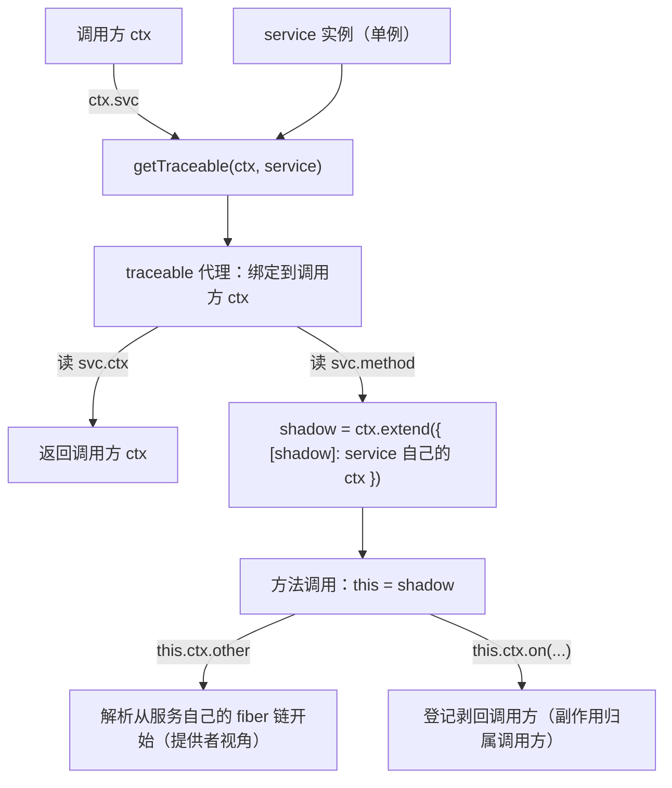

# 归属模型：traceable、shadow、receiver 到底在解决什么

总纲见 [cordis-design.md](cordis-design.md)。这篇文档专门解释 Cordis 里最反直觉、也最少被文档提及的一层：**同一个
服务实例被多个调用方使用时，"这次使用"按谁算**。读懂了这一层，`getTraceable`、`symbols.shadow`、`noShadow`、
`receiver` 这些名字才会各自有明确所指。

## 1 要解决什么问题

### 1.1 一个实例，多个主人

Cordis 的服务是**单实例**的：`ctx.llm` 在同一个作用域里永远解析到同一个对象。但它的使用者是多个插件。于是一次
`llm.stream()` 调用里同时藏着三个"谁"：

| 问题 | 正确的答案 | 为什么 |
|---|---|---|
| 服务方法里 `this.ctx.other` 按谁的依赖链解析？ | **提供者**（llm 插件） | 服务的依赖必须自洽，否则它声明的 `inject` 毫无意义 |
| 服务方法里 `this.ctx.on(...)` 注册的监听器归属给谁？ | **调用方** | 调用方卸载时，它触发的副作用必须消失 |
| 服务内部要判断"我现在代表谁"（如日志名）？ | **调用链的起点** | 日志、遥测这类功能要能归因 |

三个答案互不相同，而且任何显式 API（多传一个 `ctx` 参数、用 AsyncLocalStorage 存当前上下文）都会污染使用者的写法。
作者的解法是：让"从上下文里取出来的值"自己携带归属信息。

### 1.2 显然做法的代价

| 做法 | 代价 |
|---|---|
| 方法签名都带上 `ctx` 参数 | 使用者必须显式传递；漏传就静默走错归属 |
| 每个插件一份服务实例 | 失去"换实现只有一个入口"，初始化成本高 |
| `AsyncLocalStorage` 记录当前上下文 | 依赖运行时环境；同步语义之外的行为（并发 await）容易误判 |
| 全局"当前上下文"变量 | 并发下必然出错 |

作者选择了其中最具 JavaScript 风格的一种：**代理 + 元数据**。

## 2 作者构建的模型（artifact）

### 2.1 四个概念

| 概念 | 位置 | 一句话含义 |
|---|---|---|
| tracker 元数据 | [utils.ts:43](sources/deepseek-harness/vendor/cordis/src/utils.ts#L43)<!-- doctidex: {cross-boundary-point: sources/deepseek-harness} --> 的 `Tracker` | 挂在服务实例上的"我如何被取用"说明 |
| traceable 代理 | [utils.ts:165](sources/deepseek-harness/vendor/cordis/src/utils.ts#L165)<!-- doctidex: {cross-boundary-point: sources/deepseek-harness} --> 的 `createTraceable` | 每次从上下文取用时生成的临时身份 |
| shadow 上下文 | [utils.ts:149](sources/deepseek-harness/vendor/cordis/src/utils.ts#L149)<!-- doctidex: {cross-boundary-point: sources/deepseek-harness} --> 的 `createShadow` | "调用方上下文 + 一个指向服务自身上下文的指针" |
| receiver | [reflect.ts:135](sources/deepseek-harness/vendor/cordis/src/reflect.ts#L135)<!-- doctidex: {cross-boundary-point: sources/deepseek-harness} --> 的 trap 第三参 | 发起本次读取的对象（子上下文 / shadow / 普通对象） |

### 2.2 一张图看清关系



### 2.3 不变量

1. **取值必过 getTraceable**：上下文返回的每个服务值都经过这一层（[reflect.ts:158](sources/deepseek-harness/vendor/cordis/src/reflect.ts#L158)<!-- doctidex: {cross-boundary-point: sources/deepseek-harness} -->）。
2. **归属只影响语义，不影响类型**：类型上始终是服务类型本身（§4.3）。
3. **原对象始终可取**：`value[symbols.original]` 能拿到原对象（[utils.ts:175](sources/deepseek-harness/vendor/cordis/src/utils.ts#L175)<!-- doctidex: {cross-boundary-point: sources/deepseek-harness} -->）。

## 3 期望的使用方式（心智模型）

### 3.1 插件作者：不需要知道这一层的存在

作者希望插件作者只写 `ctx.llm.stream()`、`svc.method()`，不必考虑归属。这一层的价值恰恰在于"**它在使用者看不见的
地方把三件事做对了**"。

### 3.2 服务作者：要守两条规则

第一，服务内部读别的服务请写 `this.ctx.other`（而不是把 `ctx` 存成闭包变量）——只有通过 `this.ctx` 才会走到
shadow 机制里，解析才会按提供者的依赖链进行。第二，服务内部注册副作用（监听器、effect、子插件）时不要试图
"替调用方决定生命周期"；框架会把它们归属给调用方，这正是期望行为。

### 3.3 框架扩展者：`noShadow` 是唯一的开关

如果扩展者写的是"身份敏感"的服务（需要知道自己代表谁），就把 tracker 里的 `noShadow` 设为 `true`，保留 shadow 以便
读取 `[symbols.shadow]` 反查 origin。核心里的四个内建服务都这么做（
[events.ts:137](sources/deepseek-harness/vendor/cordis/src/events.ts#L137)<!-- doctidex: {cross-boundary-point: sources/deepseek-harness} -->、
[reflect.ts:216](sources/deepseek-harness/vendor/cordis/src/reflect.ts#L216)<!-- doctidex: {cross-boundary-point: sources/deepseek-harness} -->、
[registry.ts:202](sources/deepseek-harness/vendor/cordis/src/registry.ts#L202)<!-- doctidex: {cross-boundary-point: sources/deepseek-harness} -->、
[logger.ts:206](sources/deepseek-harness/vendor/cordis/src/logger.ts#L206)<!-- doctidex: {cross-boundary-point: sources/deepseek-harness} -->）。


### 3.4 示例：三条归属规则同时出现在一个方法里

```ts
export class Sandbox extends Service {
  constructor(ctx: Context) {
    super(ctx, 'sandbox')
  }

  async run(cmd: string) {
    // ① 解析按「提供者」：fs 与 policy 是 sandbox 插件自己声明过的依赖
    const target = this.ctx.fs.resolve(cmd)

    // ② 注册按「调用方」：这行监听器属于调用 run() 的那个插件，调用方卸载时随之注销
    this.ctx.on('agent/status', (status) => this.trace(status))

    // ③ 取值也按「调用方」：取到的是绑定到调用方上下文的代理
    return this.ctx.policy.check(target)
  }
}

// 调用方插件
export const inject = ['sandbox']
export function apply(ctx: Context) {
  void ctx.sandbox.run('ls')     // ctx.sandbox 是绑定到本插件的代理，而不是裸实例
}
```

要点：同一个 `this.ctx`，在「解析实现」「登记副作用」「再次取值」三处遵循不同规则——这正是 shadow 与剥离逻辑要
同时存在的原因。

身份敏感的服务需要保留 shadow，才能反推出「这次调用来自哪条链」：

```ts
export class ScopedLogger extends Service {
  constructor(ctx: Context) {
    super(ctx, 'scopedLogger')
    // noShadow 让框架保留下面的 shadow 上下文（其余服务会被剥回调用方）
    defineProperty(this, Service.tracker, { property: 'ctx', noShadow: true })
  }

  [Service.invoke](tag: string) {
    // 真实实现见 logger.ts:252：从内部符号读出 origin，再用它的 fiber 作为名字
    const origin = (this.ctx as any)[symbols.shadow] ?? this.ctx
    return new NamedLogger(tag, origin.fiber.name)
  }
}
```

（`defineProperty` 来自 `@deepseek-ai/cosmokit`，`symbols` 是 cordis 的内部符号表；这一段属于内部写法，扩展者只有在
确实需要身份判断时才这么写。）

## 4 用 TypeScript 表达这套设计：作者遇到的问题与解法

### 4.1 同一实例的"两种身份"无法用类型表达

服务是单例，调用方却可能有很多：同一个 `llm` 在插件 A、B 眼里应该"以谁的身份工作"不同。TypeScript 无法表达"一个值的类型随取用者变化"，作者也没有在类型层硬造（那会变成一堆泛型参数）。选择是：**类型只保证形状，身份放进运行时**——`getTraceable` 返回代理，代理按取用上下文重绑定。这一条取舍决定了本文后面所有机制存在的理由。

### 4.2 需要把"调用方"带进方法体，而 `this` 只表示接收者

方法执行时的 `this` 由**调用形式**决定（`svc.m()` 与 `const f = svc.m; f()` 不同），它天然不含"调用方是谁"。作者把调用方信息放进 receiver 的**替换**里：读方法时先包一层（`createShadowMethod`），调用时若 `thisArg === outer` 就换成 shadow。类型系统在这里完全缺席——`this` 的类型检查只看声明，运行时看到的却是被替换过的对象。

### 4.3 归属信息要挂在服务对象上，但不应污染它

代理需要知道"这个对象是服务、它用哪个字段暴露上下文、是否保留 shadow"。这些元数据放在普通字段上会出现在 `Object.keys`、JSON 与循环里；放在 `#private` 上又无法被通用逻辑读取。作者选择**非枚举的符号属性**（cosmokit 的 `defineProperty` 加 `Symbol.for('cordis.tracker')`），并用 `Tracker` 接口把三个可选字段写进类型。

### 4.4 可调用服务要同时是函数与服务

`ctx.logger('name')` 要求对象既是函数、又保留服务的原型方法。类型层用"接口加调用签名"表达（`interface LoggerService { (name?: string): Logger }`），运行时用 `createCallable` 与 `joinPrototype` 把 `Function.prototype` 与服务原型链合并。两条链都必须保留：少一条要么无法调用，要么丢方法。

实现方式值得细看：`Service` 的构造函数发现子类实现了 `[Service.invoke]` 时，会**丢弃当前实例、换成一个函数对象**——
`createCallable` 造出函数，`joinPrototype(Object.getPrototypeOf(this), Function.prototype)` 只把**原型链**接过去，构造函数
再把这个函数 `return` 出去（构造函数返回对象时，它会取代 `this`）。由此带来三条必须记住的后果：

- **只带走原型，不带走自有属性**。替换前写在实例上的自有属性会被丢掉；服务里唯一的例子是参数属性 `protected ctx`
  （TypeScript 会在构造体开头写 `this.ctx = ctx`），所以紧接着有一行 `self.ctx = ctx` 把它补回来——那不是冗余代码。
- **派生类字段与派生构造体不受影响**，因为它们在 `super()` 返回之后才执行，而此时"`this`"已经是那个函数对象：
  字段与赋值都落在新对象上。（用一个最小探针验证过：基类构造函数返回另一个对象时，派生字段为 42、替换前写下的自有属性
  为 `undefined`、`instanceof` 仍然成立。）
- **`name` 只能靠 `defineProperty`**：函数对象的 `name` 属性是只读的，直接赋值会抛 `TypeError`；`createCallable` 用的是
  cosmokit 的 `defineProperty`。

类型层面这里同样"丢信息"，而且是双重的：`Object.getPrototypeOf` 的返回类型是 `any`，`joinPrototype(proto1: {}, proto2: {})`
也只接受 `{}`，所以类的成员类型在这条路径上完全消失；调用点最后用一次断言把它接回来（例如
`createCallable(...) as unknown as LoggerService`）。也就是说，可调用服务的类型不是从类推导的，而是**手写接口**给的：
`interface LoggerService { (name?: string): Logger }`。这正是"运行时能做的事，类型系统表达不了"的又一例证。

还有一个容易卡住的实现细节：`createCallable` 的函数体引用了**看起来尚未初始化**的 `self`——
`const self = function () { …; createTraceable(self['ctx'], self, tracker) }`。这不是"提前使用变量"，而是闭包引用**绑定本身**：
函数体在调用时才求值，而那时 `self` 已经指向这个函数对象。边界可以用最小探针确认：自引用成立（`f() === f` 为 `true`）；
若在 `const` 初始化完成之前就调用它，会抛 `ReferenceError: Cannot access 'self' before initialization`（TDZ），而这在
`createCallable` 里不可能发生——函数只会在服务被使用时才被调用。

用 `self['ctx']` 而不是 `this.ctx` 也是有意为之：归属必须固定在**这个函数对象**上，而调用时的 `this` 可以是任何东西
（被摘出来单独调用、`.call(other)`、作为回调传出）。把同一个函数摘出来单独调用，`self.ctx` 依然可达——这是"归属由对象
本身决定，而不是由调用形式决定"的最小示例。

### 4.5 类型层的三处盲区（本文存在的理由）

归属、shadow、`noShadow` 都是运行时概念：类型上看不出 `ctx.svc` 返回的是代理，看不出方法里的 `this.ctx` 是"调用方派生加 origin 指针"，也看不出哪些服务保留 shadow。作者没有把它们塞进类型，而是用命名与文档承担解释成本。读这部分代码时，类型只能当形状参考，语义必须回到运行时。

## 5 机制精读

### 5.1 `getTraceable` 的四条出口

```ts
export function getTraceable<T>(ctx: Context, value: T): T {
  if (!isObject(value)) return value                                   // 原始值：无从追踪
  if (Object.hasOwn(value, symbols.shadow)) return Object.getPrototypeOf(value)  // 已是 shadow：剥一层
  const tracker = value[symbols.tracker]
  if (!tracker) return value                                           // 未标记：原样返回
  return createTraceable(ctx, value, tracker)                          // 标记过：生成绑定代理
}
```

四条出口对应四种取值场景：普通数据、**已经处在 shadow 里的上下文**（说明这次取值发生在服务内部，向上剥一层回到
调用方）、未被 tracker 标记的对象、需要重绑定的服务。

### 5.2 `createTraceable` 的 get 分支：判定顺序与场景对照

代理的 `get` 陷阱按固定顺序判定（[utils.ts:174-198](sources/deepseek-harness/vendor/cordis/src/utils.ts#L174)<!-- doctidex: {cross-boundary-point: sources/deepseek-harness} -->）。**顺序本身就是语义**：符号键必须排在
`associate` 与属性查找之前，否则内部符号会和服务的普通成员走不同通路。命中即返回，判定顺序是：

1. `prop === symbols.original` → 返回裸实例（[utils.ts:175](sources/deepseek-harness/vendor/cordis/src/utils.ts#L175)<!-- doctidex: {cross-boundary-point: sources/deepseek-harness} -->）
2. `prop === tracker.property`（服务恒为 `'ctx'`）→ 返回**取用方的** `ctx`（[utils.ts:176](sources/deepseek-harness/vendor/cordis/src/utils.ts#L176)<!-- doctidex: {cross-boundary-point: sources/deepseek-harness} -->）
3. `typeof prop === 'symbol'` → 原样透传，不做任何绑定（[utils.ts:177](sources/deepseek-harness/vendor/cordis/src/utils.ts#L177)<!-- doctidex: {cross-boundary-point: sources/deepseek-harness} -->）
4. `associate` 命中 → 转发到 `ctx['<assoc>.<prop>']`（[utils.ts:180](sources/deepseek-harness/vendor/cordis/src/utils.ts#L180)<!-- doctidex: {cross-boundary-point: sources/deepseek-harness} -->）
5. **描述符存在且含 `value`**（数据属性，含"值是 `undefined`"的字段）→ 直接取出该值，再按下面三条去向之一处理（[utils.ts:185](sources/deepseek-harness/vendor/cordis/src/utils.ts#L185)<!-- doctidex: {cross-boundary-point: sources/deepseek-harness} -->）
6. **其余情况** → 描述符不存在（属性不存在，或该属性由代理动态提供），或描述符是访问器（只有 `get`/`set`）：这类属性无法从描述符里取到值，必须真正执行一次读取，并把 receiver 设成 shadow（[utils.ts:188](sources/deepseek-harness/vendor/cordis/src/utils.ts#L188)<!-- doctidex: {cross-boundary-point: sources/deepseek-harness} -->）

取出值之后的三条去向：**自带 tracker** → 递归包装成绑定到取用方的代理（[utils.ts:191](sources/deepseek-harness/vendor/cordis/src/utils.ts#L191)<!-- doctidex: {cross-boundary-point: sources/deepseek-harness} -->）；**是函数且服务非
`noShadow`** → 包成 `createShadowMethod`，调用时把 `this` 换成 shadow（[utils.ts:194](sources/deepseek-harness/vendor/cordis/src/utils.ts#L194)<!-- doctidex: {cross-boundary-point: sources/deepseek-harness} -->）；**其余** → 原样返回（包括普通字段与
`noShadow` 服务的方法，[utils.ts:198](sources/deepseek-harness/vendor/cordis/src/utils.ts#L198)<!-- doctidex: {cross-boundary-point: sources/deepseek-harness} -->）。

第 6 支为什么把"不存在"和"访问器"合成一支：它们的共同点是**无法从描述符里直接取到值**，只能真读一次。
`getPropertyDescriptor`（[utils.ts:107](sources/deepseek-harness/vendor/cordis/src/utils.ts#L107)<!-- doctidex: {cross-boundary-point: sources/deepseek-harness} -->）沿原型链逐个调用 `Reflect.getOwnPropertyDescriptor`，找不到就返回
`undefined`，所以 `desc` 为空可能是因为属性确实不存在，也可能因为该对象是代理、值由它的 `get` 陷阱动态给出。
三种子情形在读法上完全一致——`Reflect.get(target, prop, shadow)`：访问器以 shadow 为 `this` 执行 getter；属性不存在
时得到 `undefined`（不抛错）；代理动态属性则触发它的 `get` 陷阱，receiver 同样是 shadow。

这里要分清 `Reflect.get(target, prop, shadow)` 里三个参数的分工：**属性和它的 getter 由 `target` 及其原型链提供**
（服务类原型上的 `get next()`、实例上的自有访问器，或 `target` 本身是代理时的 `get` 陷阱），**`shadow` 只负责成为
getter 里的 `this`**。也就是说 shadow 不影响"取哪个属性"，只影响"这次读取以谁的身份发生"：getter 里读 `this.ctx`
拿到的是调用方视角的上下文，读 `this.count` 则沿 shadow 的原型链回落到 traceable 代理，再回到服务实例。数据属性
与 shadow 无关——`desc.value` 已经直接给出值，这也是代码对数据属性走捷径、只在需要执行 getter 或包装方法时才造
shadow 的原因（`shadow ??=` 那一行，[utils.ts:195](sources/deepseek-harness/vendor/cordis/src/utils.ts#L195)<!-- doctidex: {cross-boundary-point: sources/deepseek-harness} -->）。


场景用一个服务来构造：设 `ctxA` 是插件 A 的上下文，`svc = ctxA.counter`。

```ts
class Counter extends Service {
  count = 0
  constructor(ctx: Context) { super(ctx, 'counter') }
  get next() { return this.count + 1 }   // 访问器
  bump() { this.count++ }                // 原型上的数据属性，值是函数
}
```

| 现场（插件 A 里写） | 命中 | 结果 |
|---|---|---|
| `svc.count` | 5 → 其余 | 直接返回字段值：不造 shadow，也不造新代理 |
| `svc.bump()` | 5 → 函数分支 | 返回包装过的方法；调用时 `this` 被换成 shadow |
| `svc.next` | 6 | getter 以 shadow 为 `this` 求值，`this.ctx` 是 A 的视角 |
| `svc.missing`（属性不存在） | 6 | 读到 `undefined`，不抛错 |
| `svc.virtual`（由代理动态提供） | 6 | 触发目标的 `get` 陷阱，receiver 同样是 shadow（构造场景） |
| `svc.ctx` | 2 | 返回 A 的上下文，而不是 Counter 自己的 |
| `svc[symbols.original]` | 1 | 返回裸实例（身份比较、交给不吃代理的库时使用） |
| `svc[symbols.tracker]` | 3 | 内部符号透传：框架读 tracker 走的就是这里 |
| `ctxA.loader.debug` | 4 | 转发到 `ctxA['loader.debug']`（需存在该上下文属性；本副本无使用者） |
| `svc.inner`（inner 自带 tracker） | 5 → tracker 分支 | 递归包装，得到绑定到 A 的 inner 代理 |

三个最容易混的现场展开：

```ts
// 现场一：svc.bump()   —— 方法调用
// get   ：命中数据属性 → 值是函数 → 包成 createShadowMethod 返回
// 调用  ：thisArg === receiver（svc）时把 this 换成 shadow
// 结果  ：this.ctx = ctxA 的派生 + 指向 counter 自己上下文的 [symbols.shadow] 指针；
//         读服务因此从 counter 的 fiber 链开始（§5.3），this.count++ 则写在共享实例上（§5.5）
```

```ts
// 现场二：svc.next     —— 访问器
// get   ：描述符不含 value → 先 createShadow → 再用 shadow 当 this 执行 getter
// 结果  ：getter 里读 this.ctx.sessions 时，作用域是调用方 A 的
//         （若直接 Reflect.get(target, 'next', receiver)，getter 的 this 就不是 shadow）
```

```ts
// 现场三：ctxA.logger.info   —— noShadow 服务
// get   ：命中数据属性 → 值是函数，但 tracker.noShadow === true，函数分支被跳过
// 结果  ：原样返回方法；调用时 this 仍是取用时的代理，
//         于是 LoggerService.invoke 能读到 this.ctx[symbols.shadow] 反查 origin
```

方向提示：`associate` 是「上下文属性 → 服务成员」；`ctx.mixin` 恰好相反，是「服务成员 → 上下文属性」。两者方向相反，
容易记混。

### 5.3 shadow 的双重含义

`createShadow`（[utils.ts:149](sources/deepseek-harness/vendor/cordis/src/utils.ts#L149)<!-- doctidex: {cross-boundary-point: sources/deepseek-harness} -->）做的是：

```ts
withProp(receiver, 'ctx', ctx.extend({ [symbols.shadow]: origin }))
```

其中 `origin` 是服务自己的 `ctx`（即 `Reflect.getOwnPropertyDescriptor(target, 'ctx').value`，Counter 自己那一份）。
所以 `this.ctx` **不是**调用方上下文本身，而是两件事的叠加：

- **调用方上下文的派生**：`ctxA.extend(...)` 让它的原型链落在 ctxA 上。真实属性（`events` / `logger` / `fiber` …）、
  `isolate` / `intercept` 标签的继承、以及"剥离 shadow 时回到哪个上下文"都由这条链决定；
- **指向 origin 的指针**：`[symbols.shadow] = origin`。解析服务时用它把**起点**换成提供者自己的 fiber（[reflect.ts:155](sources/deepseek-harness/vendor/cordis/src/reflect.ts#L155)<!-- doctidex: {cross-boundary-point: sources/deepseek-harness} -->）。

因此同一个 `this.ctx` 上，两类读取走的是不同路径：

| 读什么 | 起点 | 结果 |
|---|---|---|
| 服务名（`this.ctx.fs`） | `ctx[symbols.shadow].fiber` → **提供者自己的链**（它自己的 `store` 与祖先） | 选中的是 Counter 能看见的实现；返回的代理在 `getTraceable` 时被剥回 ctxA（非 `noShadow`），所以它的副作用记在调用方账上 |
| 真实属性与 mixin 出来的方法（`this.ctx.on`、`this.ctx.logger`） | ctxA 的原型链 | 直接按调用方上下文工作，注册/注销落在调用方的 fiber 上 |

一句话：**"看得见哪些服务"由提供者决定，"登记在谁名下"由调用方决定**。这也带来一个可观察的边界：服务方法读不到
调用方子树里的私有服务——除非调用方本身就在提供者的祖先链上（最常见的情形就是调用方挂载了这个服务插件）。这正是
`inject` 语义自洽的要求：服务用的依赖必须是它自己声明可见的，而不是碰巧的调用者。

### 5.4 剥离规则：`noShadow` 到底在控制什么

`createTraceable` 的开头有一段带注释的逻辑（[utils.ts:166-172](sources/deepseek-harness/vendor/cordis/src/utils.ts#L166)<!-- doctidex: {cross-boundary-point: sources/deepseek-harness} -->）：如果当前上下文是 shadow，且服务不是 `noShadow`，
就把 `ctx` 剥回它的原型（即调用方上下文）。效果是：**服务内部的副作用登记回调用方**。

反过来，`noShadow: true` 的服务保留 shadow，于是它可以从 `[symbols.shadow]` 里读出 origin，用来做身份判断。最典型
的例子是 logger：`[symbols.invoke]` 里 `(this.ctx[symbols.shadow] ?? this.ctx).fiber` 决定日志名
（[logger.ts:252](sources/deepseek-harness/vendor/cordis/src/logger.ts#L252)<!-- doctidex: {cross-boundary-point: sources/deepseek-harness} -->）——直接由插件调用时用调用方 fiber 的名字，被别的服务内部调用时用那个服务的名字。

两个场景对照（`ctx.logger()` 会走 `apply` → `[symbols.invoke]`，其中的 `this.ctx` 就是取用时的上下文）：

```ts
// 场景 A：插件体里直接取 logger —— 没有 shadow
export function apply(ctx: Context) {        // ctx = my-plugin 的上下文
  ctx.logger().info('boot')
  // invoke 里 this.ctx[symbols.shadow] 不存在 → 走 ?? this.ctx
  // → fiber = my-plugin 的 fiber → 日志名 hyphenate('my-plugin')
}

// 场景 B：服务方法内部取 logger —— 保留 shadow（logger 是 noShadow）
class Sandbox extends Service {
  constructor(ctx: Context) { super(ctx, 'sandbox') }

  run(cmd: string) {
    this.ctx.logger().info('run %s', cmd)
    // this.ctx = ctxA 的派生 + [symbols.shadow] = sandbox 自己的 ctx（origin）
    // → fiber = sandbox 插件的 fiber → 日志名 'sandbox'
  }
}

// 触发方：日志名仍然是 sandbox，而不是调用它的那个插件
export const inject = ['sandbox']
export function apply(ctx: Context) {
  ctx.sandbox.run('ls')      // 若按"调用方"归属，这里会显示成触发方；实际显示 sandbox
}
```

设计意图：日志应当归属到**真正写下这条日志的组件**（场景 B 里的 sandbox），而不是恰好触发它的调用方；`meta.fiber`
还把这个 fiber 一并记进日志消息，供诊断使用。


到这里可以回答"**traceable 在 trace 什么**"：不是调用栈，也不是性能追踪，而是**归属**——这次使用应当以谁的身份、
谁的依赖、谁的副作用。

### 5.5 set 与 apply：写入落在哪里、调用以谁为 this

`set` 陷阱的判定顺序与 `get` 对齐（[utils.ts:200-211](sources/deepseek-harness/vendor/cordis/src/utils.ts#L200)<!-- doctidex: {cross-boundary-point: sources/deepseek-harness} -->）：

| 现场 | 命中 | 结果 |
|---|---|---|
| `svc.count = 5`（普通字段） | 默认分支（[utils.ts:209](sources/deepseek-harness/vendor/cordis/src/utils.ts#L209)<!-- doctidex: {cross-boundary-point: sources/deepseek-harness} -->） | 以 shadow 为 receiver 写入；数据属性最终仍落在**共享实例**上 |
| `svc.value = 5`（访问器带 setter） | 默认分支 | setter 以 shadow 为 `this` 运行，其中 `this.ctx` 是调用方视角 |
| `svc.ctx = x` | tracker.property（[utils.ts:205](sources/deepseek-harness/vendor/cordis/src/utils.ts#L205)<!-- doctidex: {cross-boundary-point: sources/deepseek-harness} -->） | 返回 `false`，拒绝改写上下文引用 |
| `svc[symbols.original] = x` | 逃生分支（[utils.ts:204](sources/deepseek-harness/vendor/cordis/src/utils.ts#L204)<!-- doctidex: {cross-boundary-point: sources/deepseek-harness} -->） | 返回 `false` |
| `svc[Symbol.iterator] = x` | 符号键（[utils.ts:206](sources/deepseek-harness/vendor/cordis/src/utils.ts#L206)<!-- doctidex: {cross-boundary-point: sources/deepseek-harness} -->） | 透传到原对象 |
| `ctxA.loader.debug = v` | associate（[utils.ts:207](sources/deepseek-harness/vendor/cordis/src/utils.ts#L207)<!-- doctidex: {cross-boundary-point: sources/deepseek-harness} -->） | 写回 `ctxA['loader.debug']` |

这里需要修正一个容易想当然的结论：**写入并不总是"落在 shadow 上"**。统一换成 shadow 只保证写入时看到的 `ctx` 是调用方
视角；对普通数据属性，赋值最终仍写回共享实例。也就是说，框架保证的是"归属视角"，不是"状态隔离"——共享状态的一致性
仍要由服务自己负责。

（这条结论不是执行验证得到的，而是按 `withProps` 的实现与 JavaScript 赋值语义推导：该代理只定义了 `get`/`set` 两个陷阱，
其余陷阱（包括 `defineProperty`）透传到目标对象，所以以 shadow 为 receiver 的数据属性写入最终落在实例上。要拿到行为
证据，需要在装好依赖的环境里跑一个单实例双调用方的探针。）

`apply` 分支只对可调用服务有意义（`createCallable` 只在服务实现了 `[Service.invoke]` 时才会被使用）：

```ts
// 现场：ctxA.logger('cache')
// get   ：ctxA.logger 走服务解析，得到 traceable 代理
// apply ：applyTraceable —— 有 [symbols.invoke] 时以该代理为 this 调用它
// 结果  ：invoke 里 this.ctx 是 A 的视角，this.ctx[symbols.shadow] 可用于反查 origin
```

## 6 难点与晦涩点

### 6.1 `thisArg === outer` 在判断什么

`this` 在方法执行时必然是实例或代理，携带不了"这次调用的调用方是谁"。作者把调用方信息放进**调用时传入的 receiver
能否被替换**这件事里——`createShadowMethod`（[utils.ts:156](sources/deepseek-harness/vendor/cordis/src/utils.ts#L156)<!-- doctidex: {cross-boundary-point: sources/deepseek-harness} -->）只在 `thisArg === outer` 时把 `this` 换成 shadow，
其中 `outer` 是**当初读取这个方法时的 receiver**（通常是 traceable 代理本身）。

这一步为什么要放在 `apply` 陷阱、而不是 `get` 陷阱？因为 `svc.bump()` 在语义上是两个动作：先求值 `svc.bump`
（触发 `get`，拿到包装函数），再由 `()` 发起调用（`this` 由成员访问的基对象决定，即 `svc`）。读取的那一刻无法知道这个
函数会不会被调用、会以什么 `this` 被调用，所以"要不要换成 shadow"的判断只能推迟到调用时。


用 `svc = ctxA.counter` 构造现场：

| 现场 | 调用时的 thisArg | 判定 | 结果 |
|---|---|---|---|
| `svc.bump()` | `svc`（即 outer） | 相等 | `this` 换成 shadow：方法体里 `this.ctx` 是 A 的视角，解析从 origin 链开始 |
| `const f = svc.bump; f()` | `undefined`（严格模式；非严格模式下是 `globalThis`） | 不等 | 保留调用者的 `this`：类方法读 `this` 会抛 `TypeError`，框架不替调用者猜归属 |
| `svc.bump.call(other)` | `other` | 不等 | 保持 JS 的借用语义，不把这次调用记到服务上下文上 |
| `const g = svc.bump.bind(svc); g()` | `svc`（`bind` 已固定） | 相等 | 与 `svc.bump()` 同样重绑定 |
| `const sub = svc.sub; sub.bump()` | `sub`（读取方法时的 receiver） | 相等 | 每个代理各自捕获自己的 outer，嵌套/链式读取同样生效 |

这里讨论的是 **ECMAScript 的 `this` 绑定规则**（调用形式决定 `this`），与 TypeScript 无关：`f()` 这种没有接收者的调用，在严格模式下 `this` 就是 `undefined`，非严格模式会退化成 `globalThis`。TypeScript 只在类型层检查 `this`，不改变运行时行为；本仓库是 ESM，且类体本身始终是严格模式，所以实际拿到的就是 `undefined`。

判定式的意义就是区分两件事：**"通过服务门面做的常规方法调用"**（重绑定）与**"函数值被当作普通函数另作他用"**
（保留调用者意图）。若无条件替换，`.call` / `.apply`、方法借用、把方法当回调传递这些标准用法都会被改成"以服务身份
运行"，既违背调用者意图，也会造成错误的归属。

apply 陷阱还有第二个动作：`return getTraceable(ctx, Reflect.apply(target, thisArg, args))`——**方法的返回值也要过一遍
`getTraceable`**。因此方法返回另一个带 tracker 的对象（例如链式返回另一个服务）时，拿到的是绑定到同一个 `ctx` 的
代理，而不只是取值阶段才发生重绑定。

### 6.2 代理身份带来的连锁反应

代理让"同一实例"有了多个身份，代价是 `===` 不再成立、`instanceof` 在代理环境下不可靠。框架为此写了两处补丁：
`Service[Symbol.hasInstance]` 手写原型链比较（
[service.ts:104](sources/deepseek-harness/vendor/cordis/src/service.ts#L104)<!-- doctidex: {cross-boundary-point: sources/deepseek-harness} -->），以及 `withProps` 跳过 `constructor`（
[utils.ts:132](sources/deepseek-harness/vendor/cordis/src/utils.ts#L132)<!-- doctidex: {cross-boundary-point: sources/deepseek-harness} -->）。
扩展者写自己的服务时也会遇到同类问题。

### 6.3 一个容易误读的细节：[utils.ts:119](sources/deepseek-harness/vendor/cordis/src/utils.ts#L119)<!-- doctidex: {cross-boundary-point: sources/deepseek-harness} --> 的剥层

`getTraceable` 对"已经是 shadow"的值返回 `Object.getPrototypeOf(value)`，看起来像"丢掉了一层上下文"，实际是
**把身份从服务内部还原回调用方**——这正是 §5.4 剥离规则的入口。把这两处（119 与 170）连起来读，整条归属链才闭合。

### 6.4 为什么用 `'value' in desc` 而不是 `desc.value !== undefined`

第 5／6 两支的判断依据是"**能不能从描述符里直接拿到值**"，而不是"值是不是 `undefined`"。用 `in` 的意义正在于把
"存在、但值恰好是 `undefined`"的字段留在第 5 支：若改写成 `desc.value !== undefined`，这种字段会被误判成需要执行
getter，于是多造一层 shadow、并把读取交给 `Reflect.get`——语义上没坏，但归属判断多绕了一步。反过来，`desc` 为
`undefined`（属性不存在）与访问器描述符被并到同一支，是因为两者都无法从描述符取值：前者读出来是 `undefined`，
后者必须以正确的 `this` 执行 getter。

### 6.5 `getTraceable` 的隐含契约：shadow 必须与传入的 `ctx` 同源

`getTraceable(ctx, value)` 的第 2 条出口（[utils.ts:119](sources/deepseek-harness/vendor/cordis/src/utils.ts#L119)<!-- doctidex: {cross-boundary-point: sources/deepseek-harness} -->）对"本身就是 shadow 的 `value`"返回
`Object.getPrototypeOf(value)`，**完全忽略传入的 `ctx`**。因此这里有一条不被框架强制的契约：

> 当 `value` 是 shadow 时，传入的 `ctx` 必须与它的基底同源（通常就是创建它的那次调用所用的 ctx）。

满足它时，剥离等价于"撤销一次 `extend`"，没有信息损失；违反时函数会静默返回 shadow 的**旧基底**，把新传入的 `ctx`
丢掉。框架不校验这一点，所以它属于使用纪律，而不是类型或运行时保证。

本副本（含 dsh 产品侧）的调用点排查：

| 调用点 | value 来源 | 可能是 shadow？ | 契约是否自动成立 |
|---|---|---|---|
| [context.ts:101](sources/deepseek-harness/vendor/cordis/src/context.ts#L101)<!-- doctidex: {cross-boundary-point: sources/deepseek-harness} --> `extend()` 内部 | 上下文自身 | 是（方法体里 `this.ctx.extend(...)`） | 是：ctx 与 value 是同一对象；`extend` 还会把原指针带到新层，剥离得到的是折叠后的那一层 |
| [utils.ts:160](sources/deepseek-harness/vendor/cordis/src/utils.ts#L160)<!-- doctidex: {cross-boundary-point: sources/deepseek-harness} --> 方法返回值 | 被调方法的返回值 | 是（方法 `return this.ctx`） | 正常调用链成立（shadow 的基底就是闭包里的那个 ctx）；把 shadow 存起来跨调用使用则会失效 |
| [fiber.ts:601](sources/deepseek-harness/vendor/cordis/src/fiber.ts#L601)<!-- doctidex: {cross-boundary-point: sources/deepseek-harness} --> `check()` 调用 | 提供者服务实例 | 否 | —（实例带 tracker，走 createTraceable） |
| [reflect.ts:141](sources/deepseek-harness/vendor/cordis/src/reflect.ts#L141)<!-- doctidex: {cross-boundary-point: sources/deepseek-harness} --> 真实属性分支 | events / logger / reflect / registry / fiber … | 否 | — |
| [reflect.ts:158](sources/deepseek-harness/vendor/cordis/src/reflect.ts#L158)<!-- doctidex: {cross-boundary-point: sources/deepseek-harness} --> 服务解析 | `impl.value` | 否（除非有人把上下文当服务值 `provide`） | — |
| [reflect.ts:234](sources/deepseek-harness/vendor/cordis/src/reflect.ts#L234)<!-- doctidex: {cross-boundary-point: sources/deepseek-harness} --> `ctx.get(name)` | 同上 | 同上 | — |
| [reflect.ts:399](sources/deepseek-harness/vendor/cordis/src/reflect.ts#L399)<!-- doctidex: {cross-boundary-point: sources/deepseek-harness} --> `ctx.reflect.trace(value)` | 调用者传入的任意值 | 是 | 由调用者负责 |
| [packages/core/agent/src/index.ts:400](sources/deepseek-harness/packages/core/agent/src/index.ts#L400)<!-- doctidex: {cross-boundary-point: sources/deepseek-harness} -->、[:415](sources/deepseek-harness/packages/core/agent/src/index.ts#L415)<!-- doctidex: {cross-boundary-point: sources/deepseek-harness} --> | 注册的 factory（服务实例） | 否 | —（目的正是用当前 ctx 重新绑定它） |

唯一的真实风险来自"把 shadow 存起来跨调用使用"：服务在方法里把 `this.ctx` 存进字段，之后在另一次调用中返回它，或把它当作
服务值 `provide` 出去——此时后来的调用者拿到的是**第一次调用者的上下文**，而当前 `ctx` 被静默丢弃。实践结论：把 shadow
（方法体里的 `this.ctx`、或 noShadow 服务暴露的 `.ctx`）当作**临时把手**，只在那次调用内使用，不保存、不跨调用返回、
不作为服务值提供。

## 7 为什么不是别的做法

| 做法 | 作者的选择（推断）为什么更好 |
|---|---|
| 显式 `ctx` 参数贯穿服务方法 | 使用者必须记住传参，且服务内部仍要决定"用哪个 ctx" |
| 每插件一份服务实例 | 无法集中替换实现；作用域隔离已有 isolate 承担 |
| `AsyncLocalStorage` | 语义只覆盖异步上下文，且引入 Node 专有依赖；框架还要运行在浏览器/Workerd |
| 在类型层表达身份（如泛型 `Service<Ctx>`） | TypeScript 无法表达"同一实例按调用方变化"，只能制造类型噪音 |

## 8 未验证

`associate` 分支在产品与核心中的实际使用（本副本未检出）；`noShadow` 服务在并发调用链下的命名归属未做实验；
代理层对性能的影响未测量。

## 9 来源

- 引入副本（tag `dsh-v0.2.1-rc.3`）：[sources/deepseek-harness](sources/deepseek-harness)<!-- doctidex: {cross-boundary-point: sources/deepseek-harness} -->
  - 本文引用的文件：
    - [vendor/cordis/src/utils.ts](sources/deepseek-harness/vendor/cordis/src/utils.ts)<!-- doctidex: {cross-boundary-point: sources/deepseek-harness} -->
    - [service.ts](sources/deepseek-harness/vendor/cordis/src/service.ts)<!-- doctidex: {cross-boundary-point: sources/deepseek-harness} -->
    - [reflect.ts](sources/deepseek-harness/vendor/cordis/src/reflect.ts)<!-- doctidex: {cross-boundary-point: sources/deepseek-harness} -->
    - [logger.ts](sources/deepseek-harness/vendor/cordis/src/logger.ts)<!-- doctidex: {cross-boundary-point: sources/deepseek-harness} -->
    - [events.ts](sources/deepseek-harness/vendor/cordis/src/events.ts)<!-- doctidex: {cross-boundary-point: sources/deepseek-harness} -->
    - [vendor/cosmokit/src/misc.ts](sources/deepseek-harness/vendor/cosmokit/src/misc.ts)<!-- doctidex: {cross-boundary-point: sources/deepseek-harness} -->
